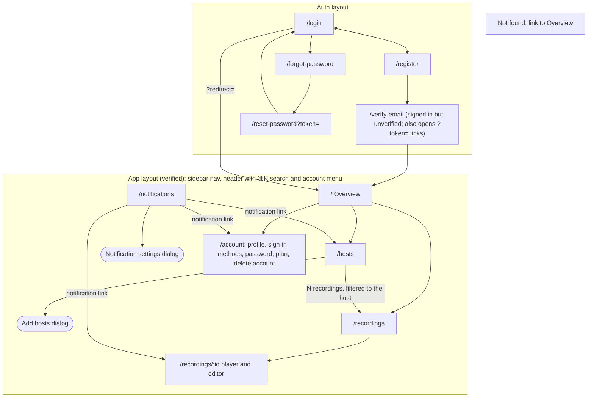
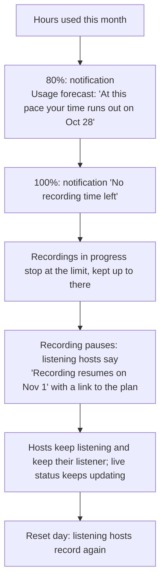

# User flows and sitemap

How people move through AutoRecordLive, agreed before any screen is drawn (ARL-1). Every design card (ARL-2 to ARL-14) draws its screens from these flows. Routes come from [`fe-arch.md`](../fe-arch.md); the principles (P1–P8) are the [product principles](../roadmap.md).

## Decisions

**Hosts and listeners:** see the [hosts user flows](./user-flows-hosts.md): listening, active listeners, live checks, recording, and removing hosts.

**Recordings:** see the [recordings user flows](./user-flows-recordings.md): watching, section downloads, and retention.

**Limits and usage**

- **Two limits: recording hours per month and active listeners.** Hours reset monthly. Downloads are unlimited (rate-limited against abuse), and storage is capped by hours and retention, so there's no download or storage quota.
- **Running out of hours pauses recording, never the app** (flow 7).
- **Usage shows on the Overview and `/account` only.** The one exception is the listener count, which `/hosts` also shows because that's where listening is managed. Anywhere else, a limit appears only where it blocks something, saying why, with a link to the plan in `/account`. That page gets an Upgrade button once billing exists.
- **`/account` says the plan once, in a sentence with its date:** "Free trial · ends Nov 2", "Trial ended Oct 22", "Starter · renews Nov 28".

**Accounts:** see the [account user flows](./user-flows-auth.md): sign-up, sign-in, email verification, and password reset.

**Notifications and messages:** see the [notifications user flows](./user-flows-notifications.md): when to use a toast, a notification, a status, an inline message, or a confirmation, and the catalog of every core message.

## Sitemap

- **Sidebar:** Overview, Hosts, Recordings, Notifications (unread badge), Account.
- **Removed from the reference:** `/add` and the export download route. Add hosts is a dialog on `/hosts`, and downloads start at once.

## Flows

Flows 1 (Follow a host), 2 (A host goes live and gets recorded), and 4 (Manage a host) are in the hosts user flows. Flows 3 (Watch, cut, or download a recording) and 6 (A recording expires) are in the recordings user flows.

### 7. Recording time runs out

Flows 8 (Sign up and verify), 9 (Sign in), and 10 (Reset password) are in the account user flows. Flows 11 (A notification reaches you), 12 (Read and act on notifications), and 13 (Choose what reaches you) are in the notifications user flows.

## Principles check

Each flow against **P4 no dead ends** and **P8 nothing disappears silently**, plus any other principle it leans on. Flows 1, 2, and 4 are checked in the hosts user flows, 3 and 6 in the recordings user flows, 8, 9, and 10 in the account user flows, and 11, 12, and 13 in the notifications user flows.

| Flow | No dead ends (P4) | Nothing disappears silently (P8) | Other |
| --- | --- | --- | --- |
| 7. Time runs out | Paused hosts say when recording resumes and link to the plan | Warnings at 80% and 100% before anything stops, plus a forecast | P1 live status keeps updating |
