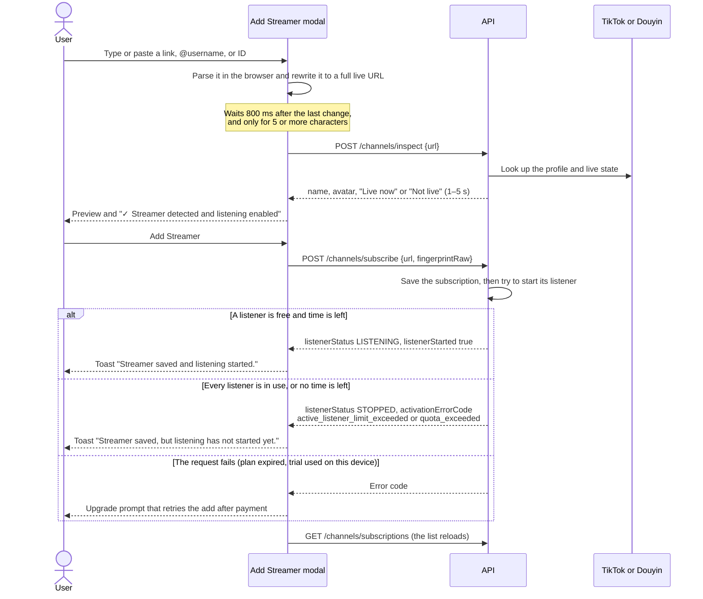
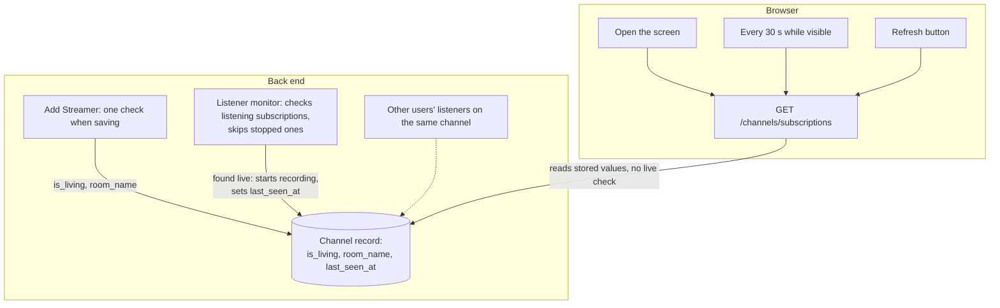
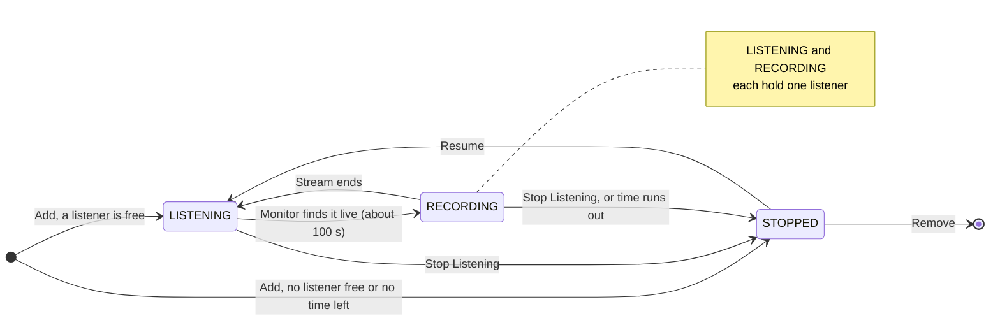

# Reference app: Streamers dashboard

How the reference app's dashboard works: the Streamers list at `/`, the Add Streamer flow, where live status comes from, and how the active listener limit is counted. The [reference app study](./ref-app-study.md) covers the whole app at overview level. Our own design is in the [hosts user flows](./user-flows-hosts.md).

Studied on 2026-10-26 with a new Free Trial account (1 active listener, 10 minutes of recording). Methods: using the screen in a browser pane about 800 px wide (and at 375 px for phones), reading the JavaScript bundle, logging every API call the page made, and making write calls on that account: adding 15 streamers, starting, stopping, and removing them, and recording a live stream until the trial's time ran out. No payments.

## Answers

**Can we add as many streamers as we want?** Yes. Saving is unlimited on every plan, the trial included, and we saved 15. The server saves the streamer even when every listener is in use, and even when no recording time is left; it's then Stopped instead of Listening, and the app barely says so. What's limited is how many listen at once. The modal adds one streamer at a time.

**Does the app check every streamer's live status when we open the screen?** No. Opening the screen, the automatic refresh every 30 seconds, and the Refresh button all read stored values: the list of 14 streamers came back in 300–500 ms, while checking one streamer on its platform takes 1–5 s. The back end checks only streamers that are listening, and its first check came about 100 seconds after Resume. Stopped streamers are never checked, so their green dot shows whatever was stored last.

**How is the active listener limit counted?** Each subscription that is Listening or Recording holds one listener; Stopped ones hold none. The count is per account and covers both platforms. It's checked at two moments: when a streamer is added, because saving also tries to switch on listening, and when you press Resume. Stop Listening frees a listener, and so does the automatic stop when recording time runs out.

## The screen

The dashboard is the Streamers list, and nothing else is on it (R1). Inside the app shell it shows:

- **Header:** "Streamers", "Manage your saved streamers and listening status.", then **Refresh** and **Add Streamer**.
- **Filter bar:** platform (All, Douyin, TikTok, YouTube, Twitch), status (All, Listening, Recording, Stopped), and the result count. Filters and the page number live in the URL (`?platform=tiktok&status=STOPPED&page=2`). The API can also filter by `is_living`, but the app removes that param from the URL and offers no live filter.
- **Grid:** 12 cards per page, newest first by the date the streamer was added, with "Page 1 of 2" paging. There's no sort, search, or count of listeners in use, so the one listening streamer among our 14 sat alone on page 2.
- **Empty state:** "No results. Try adjusting your filters or add a new streamer to get started." It's the same for a new account and for a filter that matches nothing.
- **Deep link:** `/?modal=add-channel` opens Add Streamer and then removes the param.

On phones the header shrinks to "12 Streamers", an icon Refresh, and a **Filter** button, and **Add Streamer** becomes a bar fixed to the bottom of the screen.

### Streamer card

| Part | What it shows | From |
| --- | --- | --- |
| Avatar | Profile picture, with a pulsing red dot while recording | `avatar`, `status` |
| Name | The username without `@` (e.g. `aljazeeraenglish`) | `host_name` |
| Dot and platform | Green dot when live, gray when not. No word says "Live" | `is_living`, `platform` |
| Status badge | LISTENING (green), RECORDING (blue), STOPPED (red). PENDING (amber) exists in the code but never appeared | `status_label` |
| Room line | The stream title; for an offline streamer, its display name | `room_name` |
| Clock line | "Last seen" as a date, e.g. "Oct 26, 2026, 12:33 PM", or "-" | `last_seen_at` |
| Footer | **Resume Listening** or **Stop Listening**, a trash icon (Remove), **Recording history (N)**, and a link to the live page | |

- **Resume / Stop** follows the status: Stopped shows Resume, anything else shows Stop. Neither asks for confirmation, even while recording.
- **Remove** opens a confirmation on the card itself: "Remove Streamer? Are you sure you want to unsubscribe from "lofigirl"? This action cannot be undone." It then calls `DELETE /channels/subscriptions/:id`.
- **Recording history** appears once there's a recording. Its count is the larger of `user_recording_count` and `channel_recording_count`. It shows a lock ("History available (preview only)") when the channel has more recordings than the user and the plan is below Standard. It opens `/recordings?channel_id=…`. The count can be wrong: Al Jazeera's card said "Recording history (1)" after we had two recordings of it.
- The icon buttons are named only by a hover `title` ("Unsubscribe", "Recording history (1)", "Visit") and have no `aria-label` (R4).

## Add Streamer

### What happens



The modal closes on success, and the new card appears at the top of the list. The server also creates a "Streamer added" notification, plus a "Monitoring started" one when the listener started. The last branch comes from the code; our test account never hit it.

### What the input accepts

The TikTok / Douyin toggle decides how the text is read. Pasting the other platform's link flips the toggle ("Detected Douyin link. Platform switched to Douyin."). Typing it doesn't: typing `tiktok.com/@espn` with Douyin selected says "We couldn't recognize this TikTok channel." and then "Paste a Douyin live/profile link, or enter a Douyin ID."

| Platform | Input | Sent to the server as |
| --- | --- | --- |
| TikTok | `@user` or `user` | `https://www.tiktok.com/@user/live`, username lowercased |
| TikTok | `tiktok.com/@user` or `…/@user/live` | `https://www.tiktok.com/@user/live` |
| TikTok | A short link (`vm.tiktok.com/…`, `tiktok.com/t/…`) or share text containing a link | As is; the server resolves it |
| TikTok | Any other path, such as a video link | Rejected: "We couldn't recognize this TikTok channel." |
| Douyin | An ID of 3+ letters, digits, `_`, or `-` | `https://live.douyin.com/<id>` |
| Douyin | `live.douyin.com/<id>` or `douyin.com/follow/live/<id>` | `https://live.douyin.com/<id>` |
| Douyin | A profile link (`douyin.com/user/…`), a `v.douyin.com` short link, or share text | As is; the server resolves it |

Quirks:

- **Short usernames aren't checked until you leave the field.** The check waits for 5 characters, so `@nba` sits there with Add disabled and no message. Tabbing out rewrites it to the full URL, which then gets checked.
- **Every typed username is checked twice.** The first check rewrites the input to the full URL, and that change starts a second check of the same streamer.
- **Checks are rate-limited.** Six checks at once got one `429` with `business.listening_resource_limited`, which the modal shows as "Recording resources are busy. Please try again later."
- **Some errors say the wrong thing.** A username that doesn't exist, and `@nasa`, which does, both get `404 business.user_not_found`, shown as "This account has not enabled live streaming."
- **The preview always promises listening.** It says "✓ Streamer detected and listening enabled" before anything is saved, also when every listener is in use, when no time is left, and when the streamer is already in the list (R22).
- **Adding a streamer twice changes nothing.** The server returns the existing subscription with `listenerStarted: true`, so the toast says "Streamer saved and listening started." No second card or notification appears.
- **Keyboard and screen readers:** Escape doesn't close the modal, the panel has no `role="dialog"`, focus stays on the page behind, and the close button has no label (R8).

## Live status

### Where the green dot comes from

The card's dot (`is_living`), room title, and "Last seen" are stored on the channel. Nothing on the screen asks the platform:

- **Opening the screen** calls `GET /channels/subscriptions` once. For 14 streamers it answered in 300–500 ms. One live check (`POST /channels/inspect`) takes 0.8–5 s, so the list isn't checking.
- **Every 30 seconds** while the tab is visible, the page fetches the same list again. A hidden tab skips the tick, and returning to the tab doesn't refetch the list.
- **Refresh** fetches the same list again.

The back end writes those stored values in three places:



- **When saving.** Subscribing checks the streamer once and stores the result. Al Jazeera English, 东方甄选, and 与辉同行 were live when we added them as Stopped, so their cards show a green dot. Nothing refreshes it afterwards, so a stopped streamer keeps a green dot after its stream ends (R2).
- **By the listener monitor.** Only listening subscriptions are checked. After Resume on a streamer that was already live, the card turned RECORDING 100 s and 97 s later in two tries (R28). `last_seen_at` was set at that moment and didn't change while recording.
- **By someone else.** A channel is shared by everyone who follows it, and recordings belong to the channel. 与辉同行 was live when we added it but showed "Last seen Jul 15, 2026", so another user's listener recorded it in July, and the check when saving doesn't touch `last_seen_at`. The dashed arrow is inferred from this.

### What the fields mean

| Field | Shown as | Means | Watch out |
| --- | --- | --- | --- |
| `is_living` | Green or gray dot | Live at the last check by anyone: when saving, or by a listener | Never checked again while Stopped. A color, not a word |
| `last_seen_at` | "Last seen" date, or "-" | When a listener last found the stream live and started recording it | Not the last check. Empty until the channel is first recorded; a live streamer can show "Last seen" from three months ago |
| `room_name` | Room line | The stream title from the last check; the display name when offline | As stale as `is_living` |
| `status` | Badge | The user's listener state | Says nothing about the stream: STOPPED with a green dot is common |

### What refreshes on its own

| What | When it refreshes |
| --- | --- |
| Streamer list | On open, after each action on the screen, every 30 s while visible, and on Refresh |
| Sidebar usage card (`/auth/quota`, `/payments/subscription`) | On open, every 60 s while visible, on window focus, and when the tab becomes visible |
| Notifications (`/notifications`) | On open, every 60 s while visible, on window focus, and when the tab becomes visible |

## Active listeners

### How they're counted

- Every subscription that is **LISTENING** or **RECORDING** holds one listener. **STOPPED** holds none. The code also knows PENDING, but Resume went straight to LISTENING every time.
- The count is per account, across TikTok and Douyin. Plans allow 1 (Free Trial, Pay as you go), 2 (Starter), 6 (Standard), or 10 (Premium).
- Recording uses the same listener that found the stream; it doesn't take a second one. Whether the streamer is live doesn't matter: an offline listening streamer holds its listener all day.
- No endpoint returns the count, so no screen shows "1 of 1 in use".



We didn't see a stream end while listening, so "Stream ends" comes from how the reference describes listening, not from this test.

### Where the limit is checked

| Moment | What happens when every listener is in use | What happens when no recording time is left |
| --- | --- | --- |
| Add Streamer | Saved as STOPPED with `activationErrorCode: active_listener_limit_exceeded` and the message "FREE allows 1 active listeners at a time". The toast only says "Streamer saved, but listening has not started yet." | The same, with `activationErrorCode: quota_exceeded` |
| Resume Listening | HTTP 500 `business.active_listener_limit_exceeded`, message "An error occurred". The app opens an upgrade prompt: "Your active listener limit is reached. Move up to the next plan to run more active listeners at the same time." It doesn't mention that stopping another streamer would also work (R26) | HTTP 429 `business.quota_exceeded`, message "…Please upgrade your plan or remove a channel." (removing doesn't give time back). The app opens "Add recording credits" for the $2.99 Pay as you go pack |

Both prompts have **Subscribe now** or **Buy credits**, and **Maybe later**. They remember the blocked action (`pendingAction: start_listening` with the subscription ID) so the app can restart the listener after payment.

### What frees a listener

- **Stop Listening** frees it at once. During a recording, the recording ends at the next 60-second segment and is kept: we stopped 2.5 minutes in, got a 3:00 recording, and "Recording complete" arrived about 75 s later.
- **Remove** deletes the subscription, so it should free the listener too. We only removed a stopped streamer, so this isn't tested.
- **Running out of time** frees it. The server stops the listener (STOPPED) and sends "Monitoring auto-stopped" (`listener_stopped`, `reason: quota_exceeded`, level warning). It stays stopped until someone presses Resume, or the upgrade prompt restarts it after payment.
- Quota counts in 60-second steps and lags about two minutes behind the recording, so the stop comes late. Our second recording started with 7:00 left and came out 9:00 long, and usage settled at 720 of 600 seconds (R20).

### The test, step by step

| Time (UTC) | Action | Result |
| --- | --- | --- |
| 05:23 | Add @valorant (offline) | LISTENING: 1 of 1 listeners in use |
| 05:24 | Add @nba | STOPPED, `active_listener_limit_exceeded`; toast "Streamer saved, but listening has not started yet." |
| 05:26 | Add @valorant again | The same subscription; toast "Streamer saved and listening started." |
| 05:26 | Resume @nba | HTTP 500, upgrade prompt |
| 05:27–05:28 | Add 12 more, three of them live | All STOPPED, `active_listener_limit_exceeded`; the live ones show a green dot |
| 05:31 | Stop @valorant, then Resume Al Jazeera English (live) | LISTENING |
| 05:33 | (100 s later) | RECORDING; `last_seen_at` set |
| 05:34 | Resume @valorant | HTTP 500: the recording holds the listener |
| 05:35 | Stop Al Jazeera while recording | STOPPED at once; a 3:00 recording completed at 05:37 |
| 05:37 | Resume Al Jazeera | LISTENING, then RECORDING 97 s later |
| 05:47 | (time runs out) | STOPPED by the system; "Monitoring auto-stopped". The recording came out 9:00 long, and usage settled at 720 of 600 s |
| 05:48 | Resume @valorant | HTTP 429, "Add recording credits" prompt |
| 05:48 | Add @lofigirl | Saved, STOPPED, `quota_exceeded` |

## Notifications from these actions

| Action | Notification |
| --- | --- |
| Add Streamer | "Streamer added" (`subscription_succeeded`), even when listening didn't start |
| Listening starts or stops by hand | "Monitoring started" / "Monitoring stopped" (`listener_started`, `listener_stopped`, `trigger_kind: manual`) |
| Time runs out | "Monitoring auto-stopped" (`listener_stopped`, `trigger_kind: system`, `reason: quota_exceeded`) |
| A recording ends | "Recording complete" (`recording_completed`) |

Adding a streamer that's already in the list creates nothing. A listener that can't start creates nothing either, so the reason never reaches the inbox. Each new notification also pops up at the top right of the screen. Our account had no language set, and the server stored every title and message in Chinese; the English UI rebuilds them from the type and metadata. The subscribe response also carries per-streamer notification flags (`recordingStarted`, `recordingCompleted`, …), all `false`, which no screen shows or changes.

## API

The screen uses these calls.

```jsonc
// GET /channels/subscriptions?page=1&pageSize=12&platform=&status= → { data: [...], pagination: { page, page_size, total, total_pages } }
// Also takes is_living=true|false. Newest subscribed_at first. 300–500 ms
{
  "id": "54682b…", "channel_id": "ca75cc…", "platform": "TikTok",
  "url": "https://www.tiktok.com/@aljazeeraenglish/live", "host_name": "aljazeeraenglish",
  "avatar": "https://…", "room_name": "Al Jazeera English", "is_living": true,
  "status": "RECORDING", "status_label": "Recording",
  "subscribed_at": "2026-10-26T13:28:12+08:00", "last_seen_at": "2026-10-26T13:33:26+08:00",
  "user_recording_count": 0, "channel_recording_count": 0
}

// POST /channels/inspect { url } → checks the platform, 0.8–5 s
{ "platform": "TikTok", "name": "aljazeeraenglish-Al Jazeera English", "avatar": "https://…tiktokcdn…",
  "status": "Live now", "status_label": "Live now" }   // or "Not live"

// POST /channels/subscribe { url, fingerprintRaw } → 1.5–9.4 s. fingerprintRaw is optional: calls without it worked
{
  "channelId": "c951…", "subscriptionId": "282a…", "url": "https://www.tiktok.com/@nba/live",
  "notifications": { "recordingStarted": false, "recordingCompleted": false, "recordingFailed": false, "downloadUsageWarning": false },
  "listenerStatus": "STOPPED",
  "activationErrorCode": "active_listener_limit_exceeded",   // or "quota_exceeded"
  "activationMessage": "quota exceeded: active listener limit exceeded: FREE allows 1 active listeners at a time"
}
// When the listener started: { …, "listenerStatus": "LISTENING", "listenerStarted": true }, no activation fields

// POST /channels/subscriptions/:id/start, POST …/stop, DELETE /channels/subscriptions/:id
{ "success": true }
```

Errors seen:

| Call | HTTP | `code` | `message` | The app shows |
| --- | --- | --- | --- | --- |
| inspect | 404 | `business.user_not_found` | "User not found" | "This account has not enabled live streaming." |
| inspect | 429 | `business.listening_resource_limited` | "Recording resources are busy. Please try again later." | The same |
| start | 500 | `business.active_listener_limit_exceeded` | "An error occurred" | Upgrade prompt "Your active listener limit is reached" |
| start | 429 | `business.quota_exceeded` | "Your subscription quota has been reached. Please upgrade your plan or remove a channel." | Upgrade prompt "Add recording credits" |

The code also handles `business.free_plan_expired`, `business.trial_already_used_on_device`, `business.trial_already_used_on_environment`, and `business.recording_credits_exhausted` with upgrade prompts, and `channel.unsupported` with the "couldn't recognize" error. We didn't trigger these.

## Issues

From the reference app study's known issues, the ones this screen shows:

| # | In short |
| --- | --- |
| R1 | The dashboard is only the streamer list |
| R2 | Stopped streamers are never checked, so their dot goes stale; "Last seen" means last recorded |
| R3, R4 | Cards truncate at laptop width, and card icons have no labels |
| R7 | A Refresh button, and a different refresh timer for each part of the page |
| R8 | The platform toggle, one streamer at a time, and an inaccessible modal |
| R17 | The filters list YouTube and Twitch, which can't be added |
| R20 | Recording runs past the time left |
| R21 | "Streamer added" names the room title instead of the streamer |
| R22 | The preview promises listening that may not start |
| R26 | The listener limit is invisible and answered only with an upgrade |
| R27 | The check misfires: short usernames, double checks, rate limits, wrong messages |
| R28 | Recording starts about 100 s after listening starts, even for a live streamer |

## What this means for us

Our answers are in the hosts user flows. The ones this study tests:

- **Saving and checking are separate in both apps.** The reference saves past the limit without telling you. Ours says on each row what Add will do (flow 1).
- **Never show a live dot we didn't check.** Our hosts that aren't listening say "Not checked", and an overdue check says "Status unknown · checked 8d ago", never "Last seen", which the reference uses for the last recording.
- **Many lines need one batched check** with a retry state per row. Each check can take 5 s, and the reference rate-limits them.
- **Start recording at once when the preview already says live**, instead of waiting for the first poll (R28).
- **When a full limit blocks Resume listening, say how to free a listener first** (flow 4). Keep the reference's best idea: the upgrade prompt remembers the blocked action and finishes it after payment.
- **Running out of time pauses recording but keeps hosts listening** (flow 7). The reference stops each listener, and you resume them one by one.
- **One control, like the reference, but Stop listening asks first while recording** (flow 4). The reference's Stop Listening ends a recording with one click. Per-host recording settings come later (recording rules in the roadmap).
