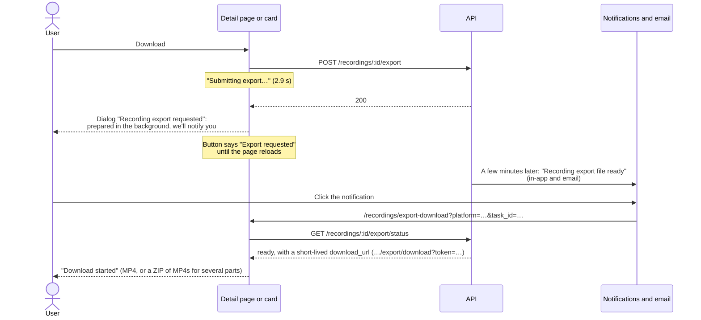

# Reference app: Recordings

How the reference app's recordings pages work: the list at `/recordings`, the detail page with its player, downloads (exports), and what the free plan locks. The [reference app study](./ref-app-study.md) covers the whole app at overview level. Our own design is in the [recordings user flows](./user-flows-recordings.md).

Studied on 2026-10-27 with the Free Trial account from the dashboard study: no recording time left and two recordings of Al Jazeera English (3:00 and 9:00) from the day before. Methods: using the screens in a browser pane 800, 1024, and 1440 px wide (and 375 px for phones), reading the JavaScript bundle, timing the requests the page made, checking the public recordings list, and requesting one export. No payments, and the export file wasn't downloaded.

## Answers

**What can you do with a recording?** Watch it, and ask for a download. Nothing else: there's no remove, rename, share, or cut, and no way to download part of a recording. The list can only be filtered by platform (and by a streamer, through a hidden URL param).

**How does download work?** Not at once. **Download** asks the server for an export, which is prepared in the background. A dialog says you'll be told when it's ready, and "Recording export file ready" arrived in the notifications a few minutes later. The page never shows that the file is ready: after a reload the button is plain **Download** again, and the code shows that pressing it then opens the file.

**What does the free plan lock?** Only the latest recording gets full playback and a Download button on its card. Older ones say "Upgrade to unlock full recording" and play a 300-second preview. The lock isn't consistent: the older recording was only 3:00 long, so the preview already covered all of it, and its detail page still had a Download button whose export went through.

## The list: `/recordings`

Inside the app shell it shows:

- **Header:** "Recordings", "Manage your automated live recordings and monitor your channel ecosystem in real-time.", and **Refresh**.
- **Filter bar:** platform (All, Douyin, TikTok, YouTube, Twitch) and the result count ("2 results"). The filter and page number live in the URL (`?platform=douyin&page=2`).
- **Grid:** 20 cards per page from `GET /recordings?offset=0&limit=20&platform=&subscribed_only=true`, newest first. There's no search, no sort, and no streamer, date, or status filter (R23).
- **Hidden streamer filter:** a streamer card's "Recording history (N)" opens `/recordings?channel_id=…`. The page looks exactly the same as the unfiltered one: no chip and no streamer name. Nothing on the page clears it: changing the platform keeps it, and only opening Recordings again from the sidebar drops it (R23). The streamer card said "Recording history (1)" and the list it opened had 2 recordings.
- **Empty state:** "No results. Try adjusting your filters or add a new streamer to get started.", the same text as the dashboard's.
- **Updates:** the list is fetched once when the page opens and again on Refresh. It doesn't poll; only the sidebar usage card and notifications refresh every 60 s.

On phones the header becomes "2 Recordings" with an icon Refresh and a **Filter** button, and the cards fill the width.

### Recording card

| Part | What it shows | From |
| --- | --- | --- |
| Thumbnail | Cover image, platform tag (top left), and duration (bottom right). Clicking it opens the detail page | `thumbnail_url`, `platform`, `duration` |
| Title | The stream's room title, e.g. "Al Jazeera English" | `title` |
| Streamer · date | Username and the day it was recorded | `streamer.username`, `date` |
| Retention | "2 days remaining" over "Available until Oct 29, 2026, 12:48 PM" | `access_expires_at` |
| Size | "623.16 MB" | `file_size` |
| Actions | **Detail**, **Download** on the latest recording only, and **Open public page** when the recording is public. Older recordings show an amber "Upgrade to unlock full recording" label instead of Download. Expired ones lose every action and say "Recording retention expired" | `is_restricted`, `restriction_reason`, `is_public` |

Our two recordings weren't public: their cards have no **Open public page**, and they're missing from the public recordings list (459 recordings that day).

The card's buttons have text labels, and the thumbnail button is named "Open recording detail".

## The detail page: `/recordings/:platform/:id`

From top to bottom below 1280 px (we used 800 and 1024 px):

- **Header card:** Back, platform, access badge ("Full playback available" in green, or "Preview only" in amber), retention badge ("2 days remaining"), the title, then streamer · date · start time.
- **Player:** a native `<video>` with controls fed by hls.js. A "Preview only" tag sits on the video when playback is limited. Under it: **Refresh** (refetches the page data), **Download**, and **Replay** (jumps back to 0:00 and plays).
- **Retention:** the same two lines as the card.
- **Recording metadata:** streamer, channel, category ("Live"), duration, file size, recording ID, status (`READY`), format (`HLS`).
- **Access state:** playback state and preview limit. The latest recording says "Full playback available" for both. An older one says "Preview only", "Preview playback is limited to the first 300 seconds.", and "Upgrade required: Upgrade your plan to unlock full playback for this recording."
- **AI sections and related recordings:** summary, outline, highlights, FAQ, and related recordings appear only when the API has them. For both of our recordings `ai-content` and `transcript` answered `404` a day after recording, so the page simply had none of these, and nothing said why.

From 1280 px, Retention, the metadata, and the access state move to a 340 px column beside the player; the AI sections always come after both, at full width. Phones get the single column at full width.

**URLs:** the platform part is ignored. `/recordings/douyin/<id>` opens a TikTok recording just like `/recordings/tiktok/<id>`. An unknown ID shows the page shell with "--" placeholders, "Error · Resource not found", and **Retry** and **Back** buttons. Expired and deleted recordings have their own messages (see Retention).

### Playback

| What we measured | Result |
| --- | --- |
| Playlist | `GET /recordings/:id/playlist.m3u8?platform=tiktok` (add `&preview=true` for a preview), 0.6–0.85 s |
| Segments | 60-second MPEG-TS files at 1920×1080, about 60–70 MB each (623 MB for 9:00, 178 MB for 3:00) |
| Where segments come from | Full playback: presigned S3 URLs straight to the Backblaze B2 bucket (`s3.us-west-004.backblazeb2.com/live-prod/records/<channel_id>/<task_id>/segment_NNN.ts`), valid for 1,440 s (24 minutes). Preview: `cdn.autorecordlive.com` with the `pt`/`ps` signature the overview describes, valid about 5 minutes |
| Loading | hls.js starts loading when the page opens, without autoplay: the 9:00 page fetched its first segment and the 3:00 preview its first two (about 120 MB) before anyone pressed Play |
| Time to first frame | Nothing plays until the first segment is in: 24.0–24.3 s from the bucket in three tries, 12.7 s from the CDN for the preview. Our connection measured about 28 Mbit/s, so this is mostly download time |
| Seeking | Jumping to 7:15 stalled about 25 s while segment 7 loaded (25.7 s and 24.2 s in two tries) |
| Captions | No `<track>`: the transcript doesn't exist for these recordings |

So every start and every seek waits for a whole 60-second segment, and the wait grows on a slower connection. A 24-minute link also means anyone watching a longer recording from the start would lose playback partway through, because hls.js doesn't fetch a finished playlist again (R18).

## Downloads (exports)

We stopped at the notification: opening it would have downloaded the file.

- **The notification doesn't say which recording.** "The recording export file for Al Jazeera English is ready. Click to download." names the room title (R21), not which of the two recordings, the file size, or how long it's kept, though its metadata carries `file_size_bytes` and `cached_until`.
- **Download again goes straight to the file.** When the export is already ready, the code skips the dialog and opens the export-download page. We didn't press it, because that would have downloaded the file.
- **The button has more states** in the code: "Retry download", "Export unavailable", and "Refresh link", with hints for "The download link expired", "already being prepared", "Your remaining full-video download quota is not enough for this recording", and "The recording export service is busy" (`recording_export_capacity_reached`).
- **Some exports end with support.** A dialog "Recording export needs support" says the export "reached a final failure and is being handled by customer support" and that retrying is disabled.
- **The export page refreshes your session first** and opens a fresh short-lived link. When the download quota is the problem, it opens the upgrade prompt and remembers `download_recording` so it can retry after payment.
- **Nothing tracks the export on the page.** `export/status` is called only by the export-download page. Reloading the detail page shows plain **Download** again, with no sign that an export is being prepared or ready: the 3:00 recording's page looked the same about 25 minutes after its file was ready.

## Free plan access

| | Latest recording | Older recordings |
| --- | --- | --- |
| Card | **Download** | "Upgrade to unlock full recording" (no Download) |
| Badges | "Full playback available" | "Preview only", "Upgrade required" |
| Playback | Full | First 300 s (`playlist.m3u8?preview=true`, at most five segments) |
| Detail page Download | Starts an export | Also starts an export, and the server accepted it |

The 3:00 recording's preview already covered the whole recording (its preview links allowed segments 0 to 2, all of them), yet it was still marked "Preview only" and "Upgrade required". We didn't download the export, so we don't know whether the server would have refused the file, as it refuses full playback of older recordings (`403`, see the overview study).

## Retention

- The trial keeps a recording **3 days** from when it finished: the 9:00 recording started at 12:39 PM on Oct 26 and is "Available until Oct 29, 2026, 12:48 PM".
- Card and detail show "N days remaining" over "Available until …", then "Expires today (N hours remaining)" on the last day.
- The code has four more phases, each with its own line and detail page message:

| Phase | Line | Detail page |
| --- | --- | --- |
| Expired | "Retention expired" | "This recording has expired. Playback, downloads, subtitles, and AI content are no longer available for this recording." |
| Deleting | "Deletion in progress" | "This recording is being deleted" |
| Deleted | "Recording deleted" | "This recording was deleted. This recording was permanently deleted and cannot be restored." |
| Unknown | "Retention pending confirmation" | — |

The overview study saw the expired and deleted cases on an older account. Our recordings expire on Oct 29, after this study.

## API

The screens use these calls (shapes are in the overview study's data shapes):

| Call | When | Time |
| --- | --- | --- |
| `GET /recordings?offset&limit=20&platform&subscribed_only=true` (plus `&channel_id=` from a streamer card) | List opens, filter changes, Refresh | 0.5–0.6 s |
| `GET /recordings/:id?platform` | Detail opens, Refresh | 0.6–1 s |
| `GET /recordings/:id/ai-content?locale&platform`, `GET …/transcript?locale&platform` | Detail opens, in parallel | 0.4 s each (`404` here) |
| `GET /recordings/:id/playlist.m3u8?platform[&preview=true]` | Detail opens | 0.6–0.85 s |
| `POST /recordings/:id/export?platform` | Download | 2.9 s |
| `GET /recordings/:id/export/status?platform` | Export-download page only | — |

The list's data hook also takes a `status` param, which the page never sends.

## Issues

From the reference app study's known issues, the ones these screens show:

| # | In short |
| --- | --- |
| R6 | Expired cards stay in the list and do nothing |
| R7 | A Refresh button on both pages; the list never updates on its own |
| R10 | The AI sections, chapters included, sit below the player; below 1280 px the details do too |
| R14, R15 | Recordings are public, and expiry is cosmetic (seen on the older account; our two recordings weren't public) |
| R16 | Recordings vanish; an unknown ID gets a generic "Resource not found" with a pointless Retry |
| R18 | Full-playback segment links expire after 24 minutes |
| R23 | Platform is the only filter, and the streamer filter is invisible |
| R29 | Every start and seek waits for a whole 60-second segment of 60–70 MB: about 25 s on our connection |
| R30 | Download is an export you wait for, and the page forgets it |
| R31 | "Preview only" and "Upgrade required" on a recording the preview fully covers; the card hides Download but the detail page offers it |
| R32 | AI content and transcript missing (`404`) with no word on the page |

## What this means for us

Our answers are in the recordings user flows. The ones this study tests:

- **Download starts at once** as a plain link to `Recording.downloadUrl`, whole or by section. No export job, no notification to wait for, no link that expires in 36 hours (R30).
- **Short segments.** About 6 s fragmented MP4 instead of 60 s MPEG-TS, so playback starts and seeks in a second or two and a section is a slice of the segment list (R29).
- **Segment links last the recording's length plus a margin**, not 24 minutes (R18).
- **Remove and restore.** The reference has no way to remove a recording; ours moves it to a recycle bin with Undo.
- **Filters you can see.** Platform, host, and search, with the host filter as a removable chip, and host cards whose count matches the list (R23).
- **One access state, said once.** We have no preview limit; when a plan does lock something, the card and detail page say the same thing, and only when it actually limits the recording (R31).
- **Say when something is missing.** If chapters or a transcript aren't ready or failed, the page says so instead of leaving a blank (R32).
- **A link that can't open says why.** Removed, expired, and deleted recordings each get their own page; an unknown ID gets "Recording not found" with a way back, not a Retry (R16).
