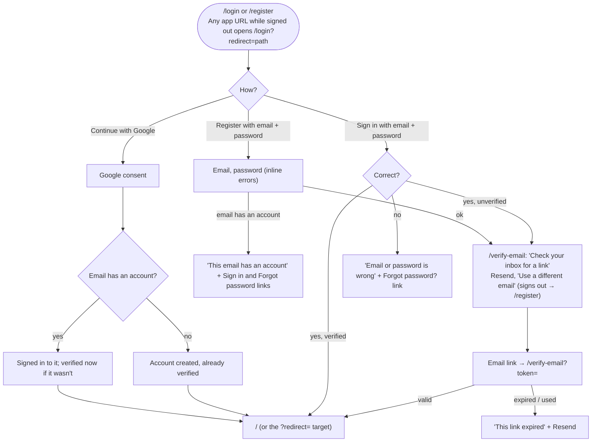
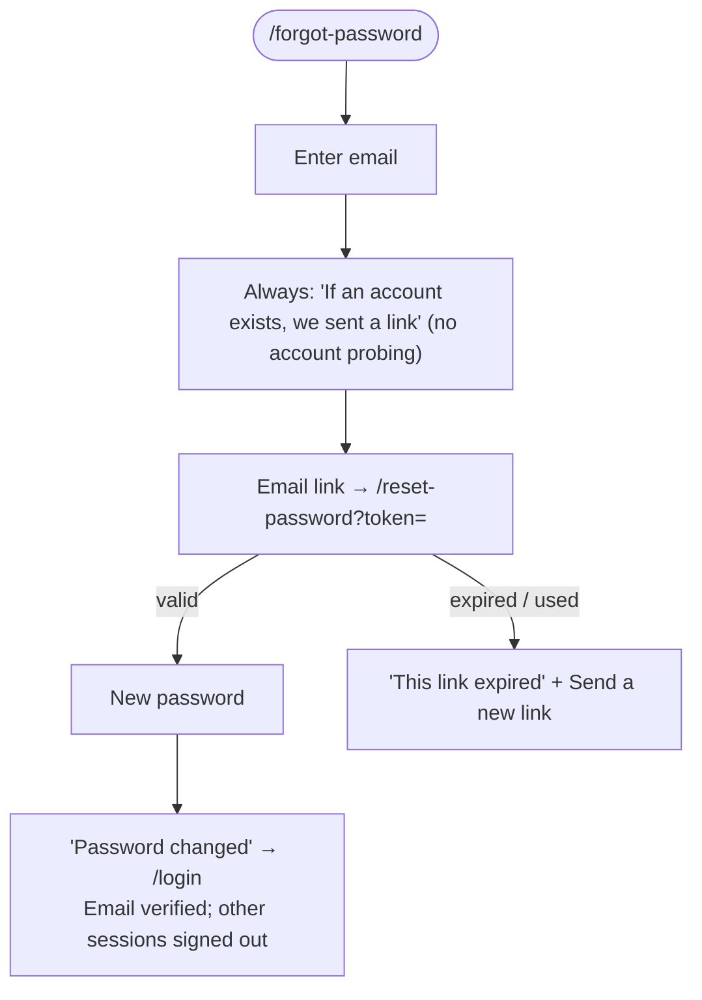

# User flows: accounts

How people sign up, sign in, verify their email, and reset a password on the auth layout pages: `/login`, `/register`, `/verify-email`, `/forgot-password`, and `/reset-password`. The rest of the app (sitemap, recordings) is in [user flows](./user-flows.md). Principles P1–P8 are the product principles in the roadmap.

Flow numbers continue those in user flows; sign-in, once flow 9, is part of flow 8.

## Rules

- **Email is the account.** The same email signs in with Google or with a password.
- **Nothing works until the email is verified.** A signed-in but unverified user only sees `/verify-email`. Google sign-ins are verified already, and so is anyone who completes a password reset.
- **Google sign-in on an unverified account takes it over.** Google proves the address, so we verify the account and drop its unproven password. This stops someone from registering another person's email first and keeping a way in.
- **Signed out:** every app route sends you to `/login?redirect=<path>`, and signing in returns you there.
- **Signed in, unverified:** every app route shows `/verify-email` until the email is verified, then continues to where you were going.

## Flows

### 8. Sign up or sign in

The sign-in error never says whether the email exists or signs in with Google only.

### 10. Reset password

This is also how a Google-only account adds a password. `/account` lists the sign-in methods an account has.

## Principles check

| Flow | No dead ends (P4) | Nothing disappears silently (P8) | Other |
| --- | --- | --- | --- |
| 8. Sign up or sign in | Wrong password links to Forgot password; the verify page offers Resend and 'Use a different email' for a typo; redirect returns you | — | — |
| 10. Reset password | Expired link offers a new one | Other sessions are signed out, and the page says so | — |
