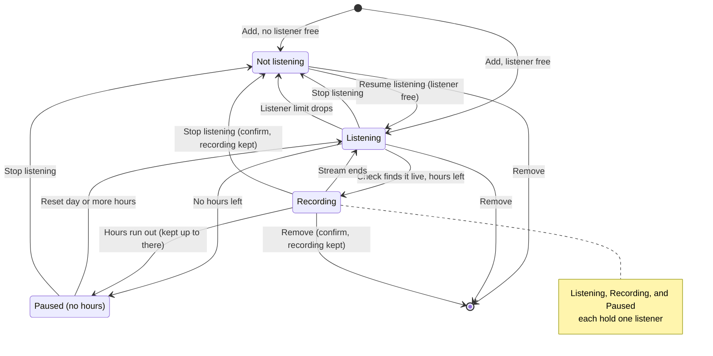
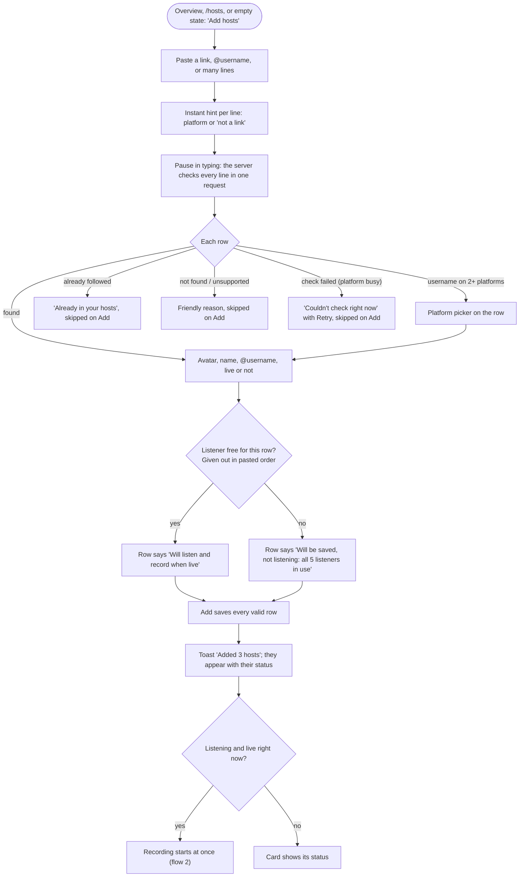
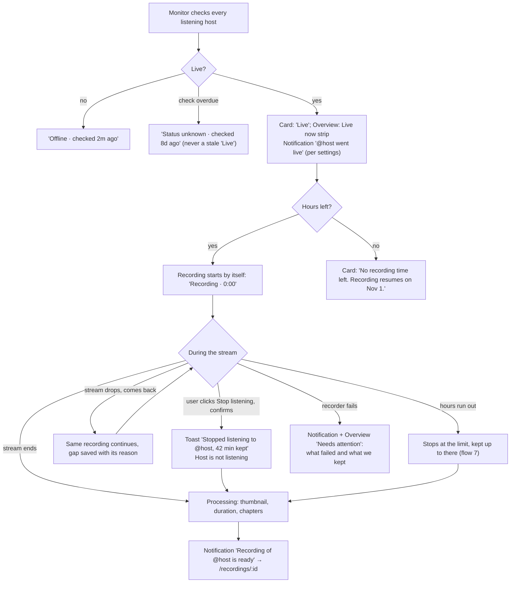
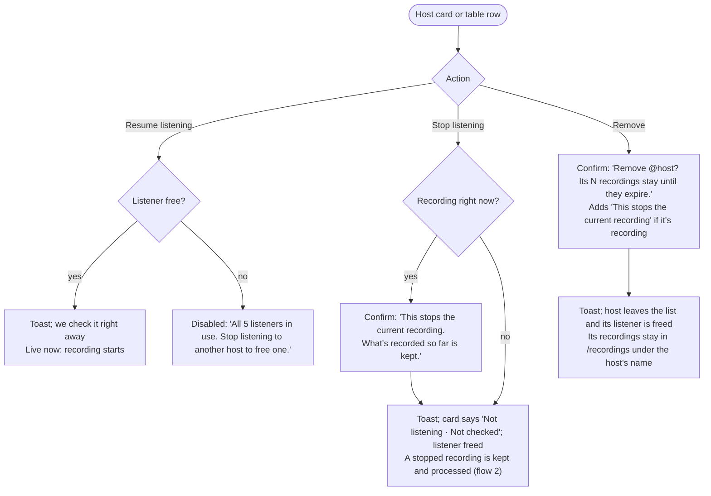
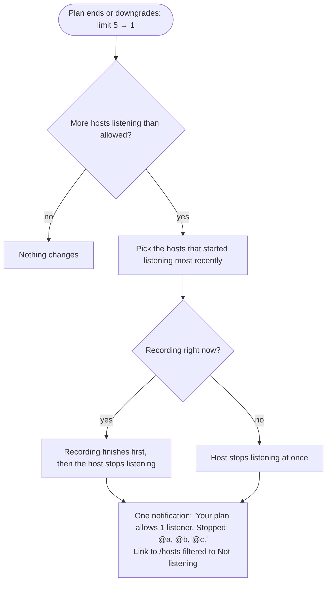

# User flows: hosts

How people follow hosts, keep them listening, and get their broadcasts recorded on `/hosts`. This is the detailed workflow for one screen; the rest of the app (sitemap, recordings) is in [user flows](./user-flows.md), and the wording of its messages is in the [notifications user flows](./user-flows-notifications.md). How the reference app does the same job: [Streamers dashboard](./ref-app-dashboard.md). Principles P1–P8 are the product principles in the roadmap.

Flow numbers (1, 2, 4) match user flows, so references elsewhere stay valid.

## Terms

| Term | Means |
| --- | --- |
| **Host** | A streamer on TikTok or Douyin that you follow. Saved once per account; the same channel can be followed by many accounts |
| **Listening** | We check the host for a live broadcast and record every broadcast it makes. One control per host turns it on or off, like the reference |
| **Not listening** | Saved in your list, never checked: no live status, alerts, or recordings |
| **Listener** | One slot of your plan's active listener limit. A listening host holds one, whether it's offline, live, or recording |
| **Check** | One request to the platform for the host's live state. Each has a time (`lastCheckedAt`) |
| **Recording** | What we capture of one broadcast for you, from when it started for you until the stream ends or you stop listening |

## Rules

**Saving**

1. You can save as many hosts as you like. Only listening is limited.
2. A host is identified by platform and channel. Adding a host already in your list does nothing and says "Already in your hosts".
3. Add accepts any mix of links, `@usernames`, IDs, and share text, one per line, of any length (P3).

**Listeners**

4. Each listening host holds one listener; a host that isn't listening holds none. The count covers both platforms.
5. New hosts start listening while a listener is free, given out in pasted order. The rest are saved as not listening, and each row says so before Add.
6. Resume listening needs a free listener. When none is free, it's disabled with the reason and how to free one, never only an upgrade.
7. If your listener limit drops (a plan ends or downgrades), the hosts that started listening most recently stop until you're within it. A recording in progress finishes first. One notification names the hosts.

**Live status**

8. Only listening hosts are checked. We never show "Live" from a check older than the check interval (P1).
9. When a check is overdue, the host shows "Status unknown · checked 8d ago". We don't say "Last seen".
10. A host that is live when it starts listening records at once, using the check we just made (the preview, or Resume's check).

**Recording**

11. A listening host that goes live records by itself while you have hours left.
12. There's no separate Stop recording or Record now: listening is the only control. Per-host settings (manual recording, schedules) come later with recording rules (roadmap).
13. Stop listening while the host is recording asks first: "This stops the current recording. What's recorded so far is kept." Then the recording ends, keeps what was captured, and the host stops listening.
14. With no hours left, hosts keep listening and keep their listeners; recording pauses until the reset day (flow 7).
15. Recordings are shared per broadcast, but your actions are yours: your Stop listening doesn't stop anyone else's recording.

**Removing**

16. Removing a host frees its listener and keeps its recordings until their retention ends. Removing a recording host stops its recording, after a confirmation that says so.

## Host states

| State | Holds a listener | Checked | Card says | Actions |
| --- | --- | --- | --- | --- |
| Listening | Yes | Yes | "Offline · checked 2m ago" or "Live" · "Listening: records when live" | Stop listening, Remove |
| Recording | Yes | Yes | "Live" · "Recording · 12:34" | Stop listening (confirm), Remove (confirm) |
| Paused (no hours) | Yes | Yes | "Listening · recording paused: no time left" | Stop listening, Remove |
| Not listening | No | No | "Not checked" · "Not listening" | Resume listening (disabled with the reason when no listener is free), Remove |

## Screen: `/hosts`

- **Header:** "Hosts", "N of 5 listeners in use", and **Add hosts**. No Refresh button: the list updates by itself (P2).
- **Filters (in the URL):** platform, and state (All, Live, Recording, Listening, Not listening). Search by name or `@username`.
- **Sort:** live and recording first, then by name. Never hide a listening host on a later page.
- **Views:** cards on phones; cards or a table on wider screens (R3). Nothing truncates the host's name at laptop width (P6).
- **Empty state:** "No hosts yet. Paste a TikTok or Douyin link to start." with **Add hosts**. A filter that matches nothing says so, with **Clear filters**.

### Host card

Every host card (and table row) answers three questions in words, with an icon beside the text (P5):

| Question | What it shows |
| --- | --- |
| Is it live? | "Live", "Offline · checked 2m ago", or "Status unknown · checked 8d ago" when a check is overdue (P1). Hosts that aren't listening say "Not checked" instead. We don't say "Last seen": in the reference it means the last time the host was seen live (R2) |
| Is it recording? | "Recording · 12:34" while recording for you |
| What happens when it goes live? | "Listening: records when live" or "Not listening". "Listening · recording paused: no time left" when hours run out |

Actions: **Stop listening** or **Resume listening**, then **Remove**. While recording, both Stop listening and Remove ask first, because they end the recording. The card also links "N recordings" to its recordings. An unavailable action stays visible, disabled, with a tooltip that says why (P4). Icon buttons have an `aria-label` (R4).

## Flows

### 1. Follow a host

- **Add is enabled** when at least one row is valid. Its label counts them: "Add 3 hosts".
- **Rows can be removed** before Add; the listener count updates.
- **Add is all-or-report:** if saving some rows fails, the dialog stays open with those rows marked, and the rest are saved.
- **Keyboard:** Escape closes the dialog, focus moves into it, and the close button is labeled (R8).
- The reference skips usernames under 5 characters until the field loses focus, rate-limits checks (R27), and waits about 100 s before recording a live host (R28).

### 2. A host goes live and gets recorded

### 4. Manage a host

### Listener limit drops

## Feedback

Every toast, notification, confirmation, and inline message in these flows, with its exact wording, is in the message catalog of the notifications user flows.

## Edge cases

| Case | What happens |
| --- | --- |
| The same host pasted twice in one Add | One row; the duplicate says "Already in this list" |
| Host renames its username | Kept by channel ID; the card shows the new name |
| Host deleted or banned on the platform | Checks fail; after a day the card says "Can't reach this host on TikTok", one notification says the same, and the host keeps listening so it records if it returns. The user can stop listening |
| Two tabs act on the same host | The server applies actions in order; the list shows the final state within the next update |
| Resume listening while another tab took the last listener | Server answers `409 listener_limit_reached`; the card shows the disabled reason |
| Stop listening at the moment the stream ends | The recording is kept; whichever comes first wins |

## API (fake API first, see roadmap step 2)

`listHosts()`, `inspectUrls(urls)`, `addHosts(urls)`, `startListening(id)`, `stopListening(id)`, `removeHost(id)`. Business errors use `409` with a code (`listener_limit_reached`), never `500` (R26).

## Principles check

| Flow | No dead ends (P4) | Nothing disappears silently (P8) | Other |
| --- | --- | --- | --- |
| 1. Follow a host | Bad rows say why, and rows we couldn't check offer Retry; rows past the listener limit say they'll be saved as not listening | Rows say exactly what Add will do (R22, R26) | P3 paste anything |
| 2. Goes live, recorded | A host that can't record says why and when it resumes | Manual stops, gaps, cut-offs, and failures say what we kept | P1 status shows how old it is |
| 4. Manage a host | A full listener limit says how to free one (the reference only offers an upgrade, R26); disabled actions say why | Stopping or removing while recording asks first and says what's kept; removing says recordings stay | P5 statuses and badges are words |
| Limit drops | The notification links to the stopped hosts | It names every host it stopped | — |
