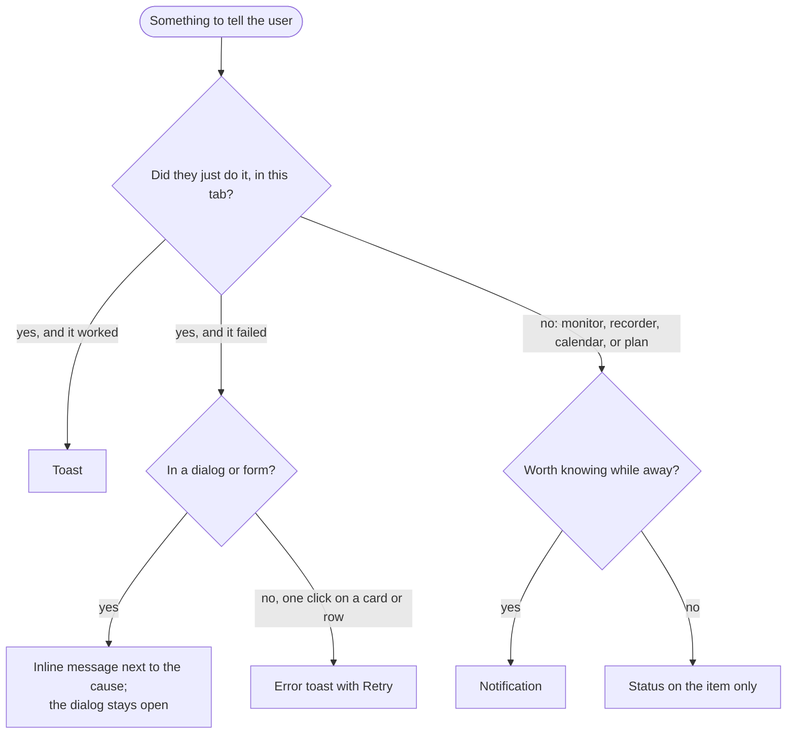
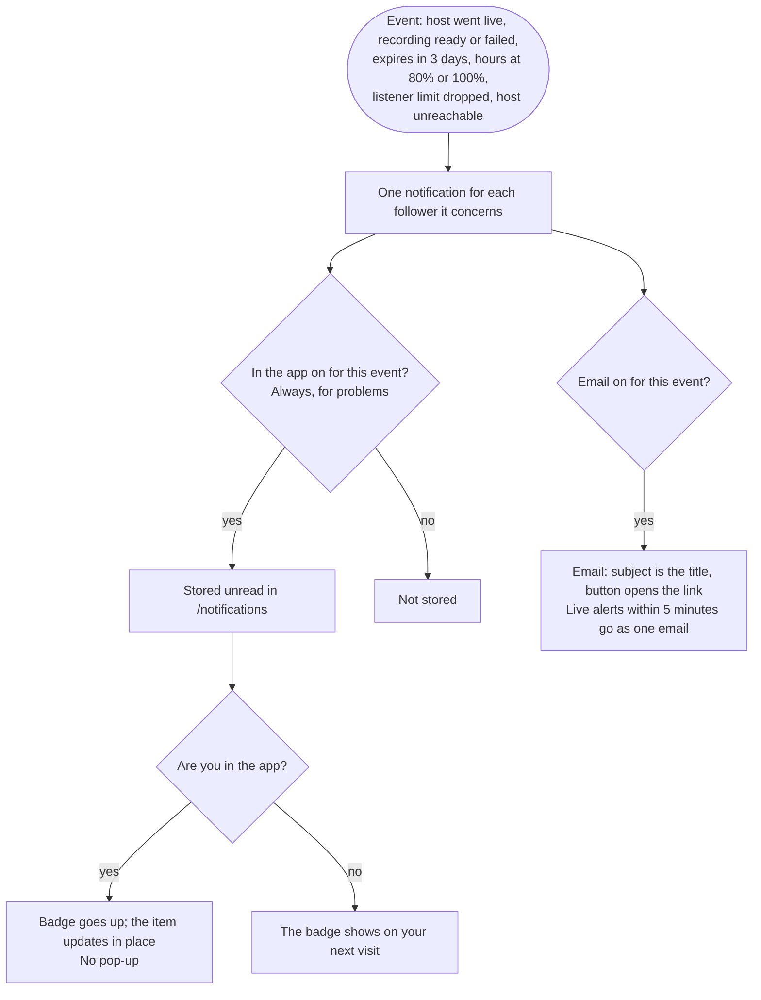
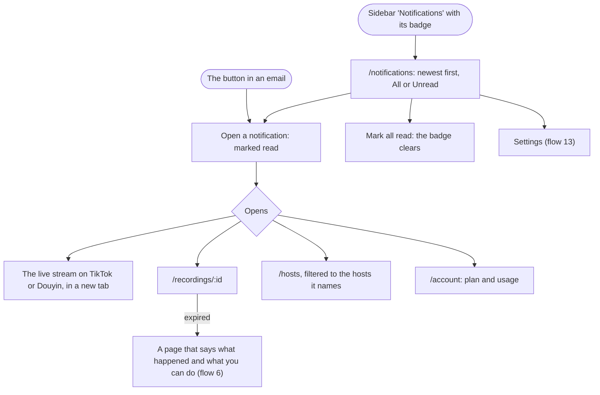
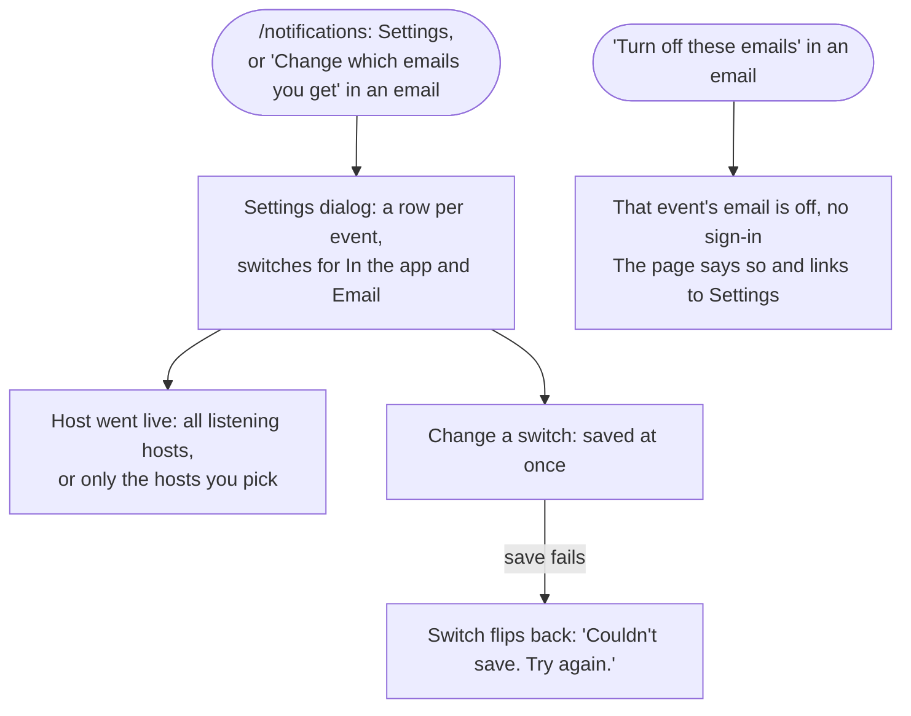

# User flows: notifications and messages

How AutoRecordLive tells people what happened: notifications in `/notifications` and by email, toasts after their own actions, statuses on the items, inline messages, and confirmations. It ends with the catalog of every core message. The rest of the app is in [user flows](./user-flows.md); how the reference app does it: [Notifications](./ref-app-notifications.md). Principles P1–P8 are the product principles in the roadmap.

Flow numbers (11, 12, 13) continue those in the other user flows.

## Kinds of message

| Kind | Use it for | Where it lives | Example |
| --- | --- | --- | --- |
| **Toast** | The result of something you just did in this tab | Bottom of the screen for a few seconds. Nothing is stored | "Listening to @host" |
| **Notification** | Something that happened without you: the monitor, the recorder, the calendar, or your plan | `/notifications` with an unread badge in the sidebar, plus email per your settings | "Recording of @host is ready" |
| **Status** | What's true right now | On the item, until it changes | "Recording · 12:34" on a host card |
| **Inline message** | Why something in front of you can't be done, or what's wrong with what you entered | Next to the row, field, or disabled button | "Already in your hosts" on an Add hosts row |
| **Confirmation** | A question before an action that stops a recording or removes something | A dialog | "Stop listening to @host?" |

## Which kind to use

1. **The same event never gets both a toast and a notification.** Adding a host gives a toast and no notification (the reference sends both, R33).
2. **Whatever stays true afterwards is also a status on the item**, so a toast or a notification is never the only place to find it.
3. **Ask first before an action that stops a recording or removes something.**

| Situation | Kind |
| --- | --- |
| You add 3 hosts | Toast |
| A host you listen to goes live | Notification, and "Live" on its card |
| You stop listening while it records | Confirmation, then a toast |
| The recording you stopped finishes processing | Notification: it finished later, without you |
| Resume listening while every listener is in use | Inline: the button is disabled and says why |
| Stop listening fails because the network dropped | Error toast with Retry |
| A pasted line isn't a host | Inline, on its row |
| A host goes offline | Status only |
| Recording time reaches 80% | Notification |

## Rules

**Toasts**

4. Say what happened to what: "Stopped listening to @host". A batch is one toast with a count: "Added 3 hosts".
5. Success toasts last 4 seconds and pause while hovered or focused. Error toasts stay until closed.
6. Error toasts are only for one-click actions on a card or row. A failure in a dialog or form shows inline, and the dialog stays open.
7. At most 3 show at once; a fourth pushes out the oldest. Bottom right on wide screens, bottom center on phones. Screen readers announce them.

**Notifications**

8. The server creates one per event for each person it concerns, of the types in the catalog. Each has a type, a level, a time, the host or recording it's about, and a link.
9. The browser builds the text from the type and its values, in the language you're reading in. The API sends no sentences, so no notification stays in the language the account had when it was sent.
10. Hosts are named by display name and @username, never by stream title (R21).
11. Every notification opens the thing it's about. When that thing is gone, the link opens the page that says what happened (flow 6), never a dead end (R16, R35).
12. A new notification raises the unread badge and updates the item in place. It never pops up over the page; browser push, in phase 3, is the opt-in way to be interrupted (R37).
13. Opening a notification marks it read, and so does following its email's button. Mark all read marks the rest. Visiting the page marks nothing, and there's no delete.
14. Problems always show in the app: a failed recording, one about to expire, usage warnings, a listener limit drop, and a host we can't reach (P8). You choose which go by email, and whether live alerts and ready recordings show at all.

**Email**

15. Each notification with email on sends one email, with the title as its subject and a button that opens the link. Live alerts within 5 minutes of each other share one email.
16. Every notification email ends with "Turn off these emails", which works without signing in, and "Change which emails you get", which opens the settings.
17. Account emails aren't notifications. They always send and never appear in the inbox (see Account emails in the catalog).

## Screen: `/notifications`

- **Header:** "Notifications", **Mark all read**, and **Settings**. No Refresh button (P2).
- **Filter:** All or Unread, in the URL (`?filter=unread`).
- **List:** newest first, 20 at a time with "Load more". New notifications appear at the top as they arrive.
- **Row:** level icon, title, message, and time ("3h ago"; the exact time on hover). Unread rows have a dot and a bold title, and screen readers hear "Unread". Each row is a link, so it can open in a new tab.
- **Empty:** "No notifications yet. We'll tell you when a host goes live, a recording is ready, or something needs you." With Unread selected: "You're all caught up." and **Show all**.
- **Failed to load:** "Couldn't load notifications" with Retry.
- **Badge:** the unread count on the sidebar's Notifications link ("99+" above 99), read out as "Notifications, 3 unread". On phones, the menu button shows a dot while anything is unread.

### Settings dialog

| Event | In the app | Email, by default |
| --- | --- | --- |
| Host went live | On or off, for all listening hosts or only the hosts you pick | Off |
| Recording ready | On or off | Off |
| Recording failed | Always | On |
| Recording expires soon | Always | On |
| Recording time at 80% and 100% | Always | On |
| Listener limit dropped | Always | On |
| Can't reach a host | Always | On |

- An "Always" switch is on and disabled, with the tooltip "Problems always show in the app."
- Each switch saves at once, for what happens next; notifications already sent stay as they are.
- Phase 3 adds Telegram, Discord webhook, and browser push columns (roadmap).

## Flows

### 11. A notification reaches you

### 12. Read and act on notifications

A signed-out user who follows an email's button signs in first and then lands on its link (flow 9).

### 13. Choose what reaches you

## Message catalog

Every core message, by kind. The ID names the message in code, and a notification's ID is its `type` in the API. `@host` stands for the host's display name and @username, like "Lofi Girl (@lofigirl)". Numbers and dates are examples.

### Notifications

| ID | When | Title · message | Level | Opens |
| --- | --- | --- | --- | --- |
| `host.wentLive` | A listening host goes live | "@host went live" · "Recording now." With no hours left: "Not recording: no time left. Recording resumes on Nov 1." | info | The live stream on TikTok or Douyin |
| `recording.ready` | A recording finishes processing | "Recording of @host is ready" · "2h 14m, recorded Oct 25." Adds "96% captured." when it has gaps | success | `/recordings/:id` |
| `recording.failed` | The recorder fails | "Recording of @host failed" · what failed and what we kept: "The stream stopped sending video at 21:40. We kept 1h 12m." | error | `/recordings/:id`, or the host on `/hosts` when nothing was kept |
| `recording.expiresSoon` | 3 days before retention ends | "Recording of @host expires Oct 3" · "Download it to keep it." | warning | `/recordings/:id` |
| `usage.warning` | 80% of the month's hours are used | "80% of your recording time used" · "At this pace your time runs out on Oct 28." Without a forecast: "It resets Nov 1." | warning | `/account` |
| `usage.exhausted` | Every hour is used | "No recording time left" · "Recordings in progress stopped, and what they captured is kept. Hosts keep listening; recording resumes on Nov 1." | warning | `/account` |
| `hosts.limitDropped` | Your listener limit drops below the hosts listening | "Your plan allows 1 listener" · "Stopped: @a, @b, @c." | warning | `/hosts`, filtered to Not listening |
| `host.unreachable` | Checks of a listening host have failed for a day | "Can't reach @host on TikTok" · "It may have been deleted or banned. We'll keep checking and record if it comes back." | warning | `/hosts`, searched for the host |

### Toasts

| ID | After | Text | Action |
| --- | --- | --- | --- |
| `hosts.added` | Add hosts | "Added 3 hosts", or "Added @host" for one. When some couldn't listen: "Added 3 hosts. 2 saved, not listening." | — |
| `host.listening` | Resume listening | "Listening to @host" | — |
| `host.stopped` | Stop listening | "Stopped listening to @host". If it was recording: "Stopped listening to @host, 42 min kept" | — |
| `host.removed` | Remove a host, after confirming | "Removed @host" | — |
| `account.saved` | Save on `/account` | "Saved" | — |
| `auth.emailSent` | Resend on `/verify-email` | "Sent. Check your inbox." | — |
| `action.failed` | A one-click action fails | "Couldn't stop listening to @host.", with the reason when we know it | Retry |

No toast after a download (the browser shows it), Mark all read or a settings switch (they show their own state), or opening a notification.

### Confirmations

| ID | Before | Title · body | Buttons |
| --- | --- | --- | --- |
| `host.stop.confirm` | Stop listening while it records | "Stop listening to @host?" · "This stops the current recording. What's recorded so far is kept." | **Stop listening**, Cancel |
| `host.remove.confirm` | Remove a host | "Remove @host?" · "Its 12 recordings stay until they expire." While recording, it adds "This stops the current recording. What's recorded so far is kept." | **Remove**, Cancel |
| `account.delete.confirm` | Delete account on `/account` | "Delete your account?" · "Your hosts and recordings are deleted for good, and you're signed out. This can't be undone." | **Delete account**, Cancel |

### Inline messages

| ID | Where | Text |
| --- | --- | --- |
| `addHosts.willListen` | Add hosts row, a listener is free | "Will listen and record when live" |
| `addHosts.notListening` | Add hosts row, no listener free | "Will be saved, not listening: all 5 listeners in use" |
| `addHosts.duplicate` | Add hosts row, already followed | "Already in your hosts" |
| `addHosts.repeated` | Add hosts row, pasted twice | "Already in this list" |
| `addHosts.notFound` | Add hosts row, no such account | "Not found on TikTok" |
| `addHosts.unsupported` | Add hosts row, a link from another site | "Only TikTok and Douyin links work for now" |
| `addHosts.checkFailed` | Add hosts row, the platform didn't answer | "Couldn't check right now", with Retry |
| `host.resumeBlocked` | Tooltip on a disabled Resume listening | "All 5 listeners in use. Stop listening to another host to free one." |
| `page.loadFailed` | A page whose data didn't load | "Couldn't load your hosts", with Retry |
| `settings.saveFailed` | Beside a settings switch that didn't save | "Couldn't save. Try again." |
| `player.failed` | The player, after its automatic retry | "This recording won't play right now", with Retry and Download |
| `auth.emailTaken` | `/register` | "This email has an account", with Sign in and Forgot password links |
| `auth.wrongPassword` | `/login` | "Email or password is wrong", with a Forgot password? link |
| `auth.checkInbox` | `/verify-email` | "Check your inbox for a link" |
| `auth.linkSent` | `/forgot-password` | "If an account exists, we sent a link" |
| `auth.linkExpired` | A verify or reset link that expired or was used | "This link expired", with Resend or Send a new link |
| `auth.passwordChanged` | `/login` after a reset | "Password changed. You're signed out on other devices." |

### Statuses

Statuses are defined with their screens: host states in the hosts user flows, and recording states in the recordings user flows. App-wide:

| ID | When | Status | Where |
| --- | --- | --- | --- |
| `app.reconnecting` | The live connection drops | "Reconnecting…" | Header, quiet |
| `app.updateFailed` | A background update failed | "Couldn't update · Retry" | Beside the list's title |
| `usage.hours` | Recording time used this month | "Used 12h of 50h · resets Nov 1" | Overview, `/account` |
| `usage.listeners` | Listeners held by listening hosts | "3 of 5 listeners in use" | `/hosts`, Overview, `/account` |

### Account emails

| ID | When | Subject |
| --- | --- | --- |
| `email.verify` | Register, or Resend | "Verify your email" |
| `email.resetPassword` | Forgot password | "Reset your password" |
| `email.passwordChanged` | A password is set or changed | "Your password was changed", with "Not you? Reset it" |

## Edge cases

| Case | What happens |
| --- | --- |
| Several hosts go live at once | One notification each, and one email (rule 15) |
| A stream drops and comes back during one broadcast | No second live alert: the recording continues, with the gap marked |
| You're on the page a notification is about when it arrives | The page updates in place, and the notification still arrives unread |
| You read notifications in another tab or device | The badge catches up when you come back to the tab, and at once when real-time updates exist |
| A host you picked for live alerts is removed | It leaves your pick |
| Several people follow the same host | Each gets their own notifications; settings and read state are per person |

## API (fake API first, see roadmap step 2)

`listNotifications({ unreadOnly }, cursor?)`, `getUnreadCount()`, `markRead(id)`, `markAllRead()`, `getNotificationSettings()`, `updateNotificationSettings(settings)`. A notification is `{ id, type, level, createdAt, readAt, host, recordingId, values, link }`: `type` is an ID from the catalog, and the browser builds the text from it and `values`.

## Principles check

| Flow | No dead ends (P4) | Nothing disappears silently (P8) | Other |
| --- | --- | --- | --- |
| 11. A notification reaches you | Every notification opens the thing it's about | Problems always show in the app, and go by email unless you turn that off | P2 the badge updates by itself |
| 12. Read and act | A link to something gone opens a page that says why | — | P5 each level has an icon, and the title says it in words |
| 13. Choose what reaches you | Switches that can't be turned off say why | A failed save flips back and says so | — |
