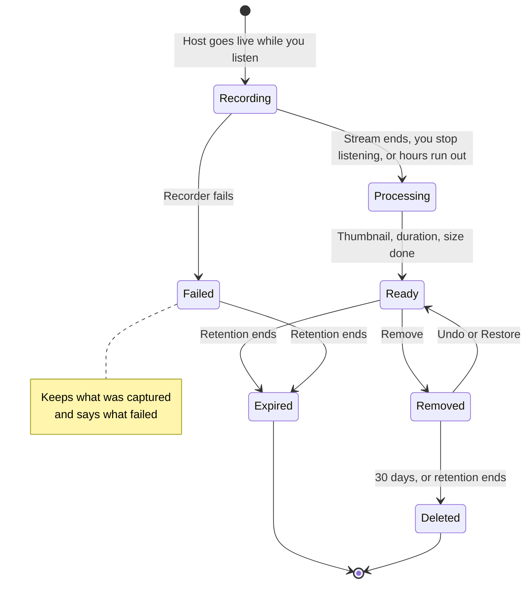
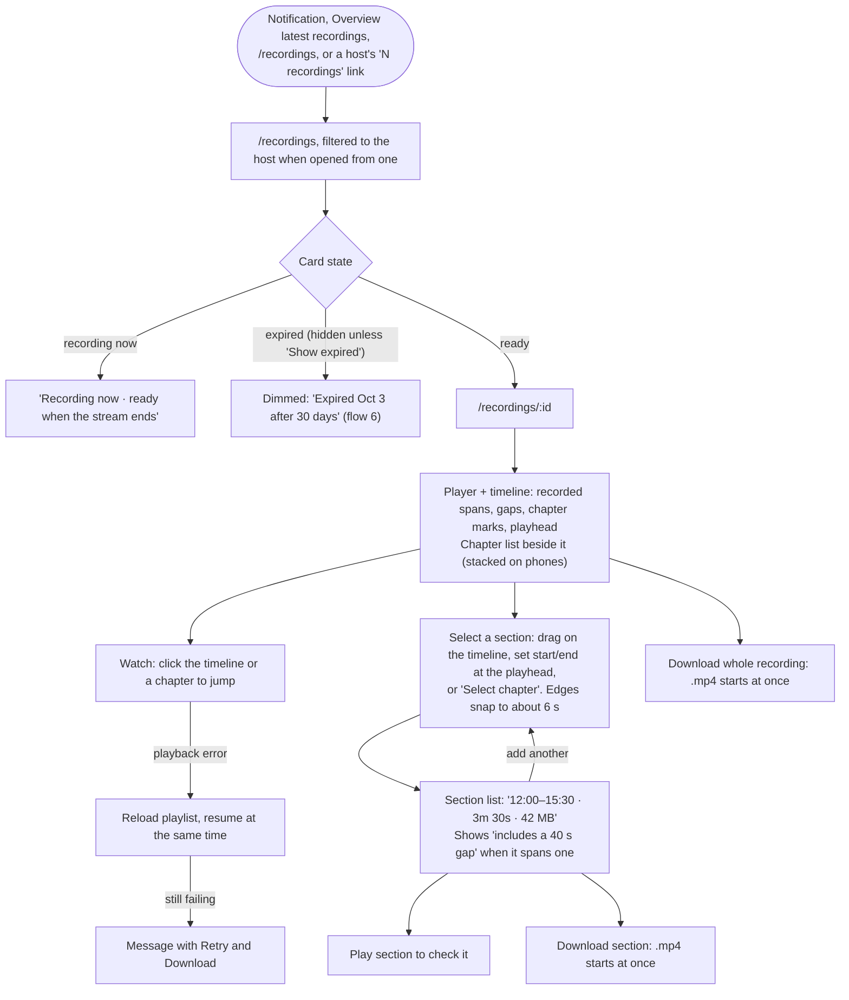
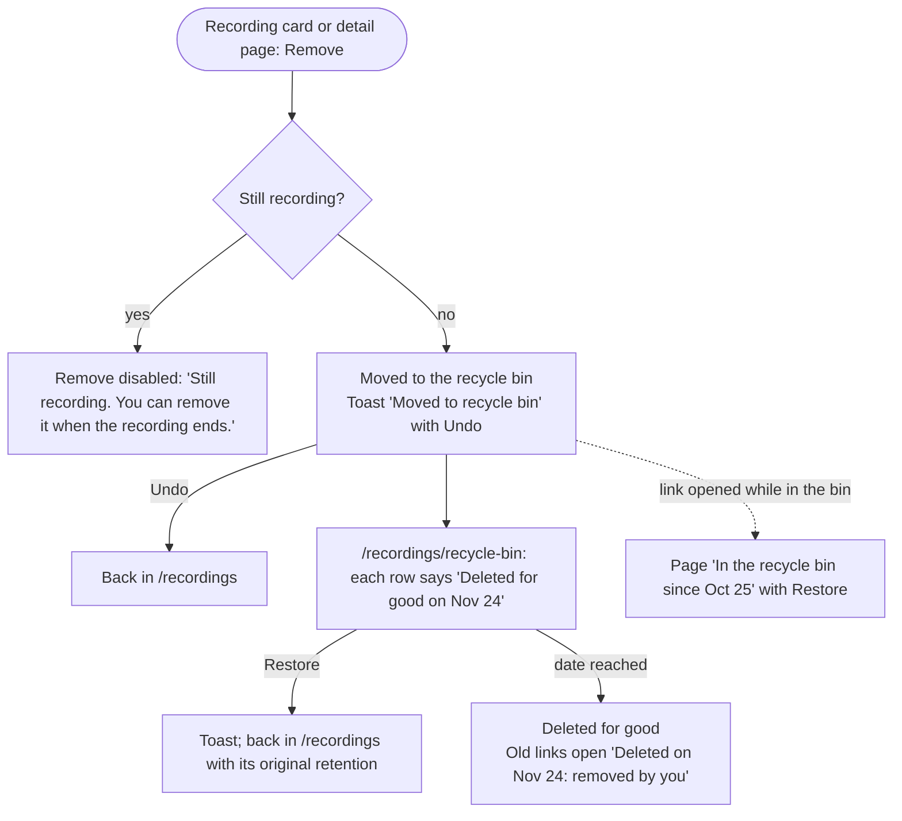
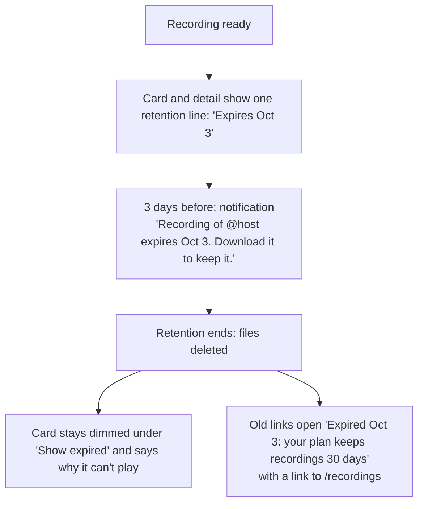

# User flows: recordings

How people find, watch, cut, download, remove, and lose recordings on `/recordings`, `/recordings/:id`, and the recycle bin. This is the detailed workflow for those screens; the rest of the app (sitemap, limits) is in [user flows](./user-flows.md), and the wording of its messages is in the [notifications user flows](./user-flows-notifications.md). How the reference app does the same job: [Recordings](./ref-app-recordings.md). Principles P1–P8 are the product principles in the roadmap.

Flow numbers (3, 5, 6) match user flows, so references elsewhere stay valid.

## Terms

| Term | Means |
| --- | --- |
| **Recording** | What we captured of one broadcast for you. Recordings are shared per broadcast, but each follower has their own span, list, and actions |
| **Part** | A recording is one part unless the stream changed format mid-broadcast; each part downloads as its own `.mp4` |
| **Gap** | A span where the stream dropped and we reconnected. It's saved with its reason and shown on the timeline |
| **Section** | A span you select on the timeline to download on its own |
| **Retention** | How long your plan keeps a recording after it ends. Then its files are deleted |
| **Recycle bin** | Where a removed recording waits for 30 days, or until its retention ends if that's sooner |

## Rules

**Who sees what**

1. You see only recordings of hosts you follow, made while you were listening. Nothing is public, and another user's recording link opens "Recording not found" (P7).
2. Removing a host keeps its recordings until their retention ends, under the host's name.

**Watching**

3. Playback starts in a second or two and seeking is quick: segments are about 6 s (R29). Segment links stay valid for the recording's length plus a margin (R18).
4. A recording in progress shows on the list as "Recording now · ready when the stream ends". Watching it while it records comes later (watch while recording in the roadmap).
5. Chapters and the transcript come after the recording is ready. Until then the page says "Chapters are being prepared"; if they fail it says "Couldn't make chapters for this recording". The page never leaves a silent blank (R32).

**Downloading**

6. Download starts at once as a plain `.mp4` link, for the whole recording or a section. There's no export job, notification, or download quota; downloads are rate-limited against abuse (R30).
7. Section edges snap to segments (about 6 s), so the file starts and ends where the timeline shows.
8. A recording with more than one part downloads one `.mp4` per part, and the Download button says how many.

**Removing**

9. Remove moves a recording to the recycle bin, with Undo in the toast. You can't remove a recording while it's still recording.
10. The bin keeps it for 30 days, or until its retention ends if that's sooner. Then it's deleted for good. There's no "delete forever" button.
11. Restore puts it back in `/recordings` with its original retention.
12. Removing doesn't give back recording time, and it hides the recording only for you: others who follow the host keep theirs.

**Retention**

13. Every recording shows one retention line: "Expires Oct 3" ("Expires today" on the last day).
14. Three days before, a notification says "Recording of @host expires Oct 3. Download it to keep it."
15. When retention ends, the files are deleted and the API stops serving them (R15). The card stays, dimmed, behind "Show expired".

## Recording states

| State | On the list | Can play | Can download | Actions |
| --- | --- | --- | --- | --- |
| Recording | "Recording now · ready when the stream ends" | No | No | Remove disabled with the reason |
| Processing | "Processing · ready in a minute" | No | No | Remove |
| Ready | Thumbnail, duration, "Expires Oct 3"; "96% captured" when it has gaps | Yes | Yes | Download, Remove |
| Failed | "Recording failed at 12:40 · 38 min kept" | What was kept | What was kept | Download, Remove |
| Removed | Only in the recycle bin: "Deleted for good on Nov 24" | No | No | Restore |
| Expired | Dimmed, behind "Show expired": "Expired Oct 3 after 30 days" | No | No | — |

## Screen: `/recordings`

- **Header:** "Recordings", the result count, and a link to the recycle bin. No Refresh button: the list updates by itself (P2).
- **Filters (in the URL):** search by title or host (`?q=`), platform (`?platform=`), host (`?host=`, shown as a removable chip with the host's name), and a "Show expired" switch (`?expired=1`, off by default). Platforms come from the list of supported ones (R17).
- **Sort:** newest first, or longest (`?sort=longest`).
- **Paging:** 20 cards, then **Load more**.
- **Empty states:** "No recordings yet. Hosts you listen to are recorded when they go live." with a link to `/hosts`. A filter that matches nothing says so, with **Clear filters**.

### Recording card

- Thumbnail with platform tag and duration; title (the room title); host name and `@username` · date; size.
- One retention line, and one status line when it's not plain Ready (see the states table).
- Actions: **Download** and **Remove**, with text labels or an `aria-label` (P5). An unavailable action stays visible, disabled, with a tooltip that says why (P4).
- A host card's "N recordings" opens this list filtered to the host, and the count matches the list.

## Screen: `/recordings/:id`

- **Two columns on desktop, stacked on phones** (R10). Left: header (Back, platform, title, host, date, retention line), the player, the timeline, and the section list. Right: chapters, then metadata.
- **Player:** fits portrait and landscape video without empty space. On an error it reloads the playlist and resumes at the same time; if that fails, a message with **Retry** and **Download**.
- **Timeline:** recorded spans, gaps as hatched spans (hovering one says why), chapter marks, and the playhead. Handles are big enough to drag on a phone (P6).
- **Chapters:** clicking one jumps the video; the current one is highlighted. Their status shows when they aren't ready (rule 5).
- **Captions:** from the transcript, loaded from our own origin.

### Pages for recordings that aren't there

A link to a recording you can't open gets a page that says what happened, when, and what you can do, never the generic not-found page (R16):

| Case | Page says | Actions |
| --- | --- | --- |
| In the recycle bin | "In the recycle bin since Oct 25. Deleted for good on Nov 24." | Restore, Back to Recordings |
| Expired | "Expired Oct 3: your plan keeps recordings 30 days." | Back to Recordings |
| Deleted | "Deleted on Nov 24: removed by you" (or "after retention ended") | Back to Recordings |
| Not yours, or no such ID | "Recording not found" | Back to Recordings |

## Screen: `/recordings/recycle-bin`

Removed recordings, newest removed first, each with "Deleted for good on Nov 24" and **Restore**. Empty state: "Nothing in the recycle bin."

## Flows

### 3. Watch, cut, or download a recording

The reference makes you wait for an export and a notification, and its 60-second segments made every seek wait about 25 s on our connection (R29, R30).

### 5. Remove and restore a recording

The reference has no way to remove a recording.

### 6. A recording expires

## Feedback

| Event | Toast | Notification | Status on the card |
| --- | --- | --- | --- |
| Recording started | — | "@host went live" · "Recording now." (per settings) | "Recording now" |
| Recording ready | — | "Recording of @host is ready" | Ready |
| Recording failed | — | What failed and what we kept | "Recording failed at 12:40 · 38 min kept" |
| Download | — (the browser shows the download) | — | — |
| Removed | "Moved to recycle bin" with Undo | — | Leaves the list |
| Restored | "Restored to Recordings" | — | Back in the list |
| Expires in 3 days | — | "Recording of @host expires Oct 3. Download it to keep it." | "Expires Oct 3" |
| Expired | — | — | Dimmed, behind "Show expired" |

## Edge cases

| Case | What happens |
| --- | --- |
| A section spans a gap | The section row says "includes a 40 s gap" before download; the file skips the gap |
| Retention ends while it's in the recycle bin | It's deleted for good on that day; the bin row already showed that date |
| Remove while a download is running | The download finishes; its link was signed before the removal |
| Two followers of the same host | Each removes or restores only their own; the files stay while anyone still has the recording |
| The host is removed | Its recordings stay until they expire; the host filter still works by name |
| A link with the wrong or old URL format | Opens by ID; the platform isn't part of our URL |

## API (fake API first, see roadmap step 2)

`listRecordings(filters, cursor?)`, `getRecording(id)`, `getSectionDownloadUrl(id, startSec, endSec)`, `removeRecording(id)`, `restoreRecording(id)`, `listRemovedRecordings(cursor?)`. `Recording` carries `playlistUrl`, `subtitlesUrl`, and `downloadUrl` as signed URLs. A recording you can't open answers `404 recording_not_found`, or `410` with `recording_removed`, `recording_expired`, or `recording_deleted` plus when it happened, so the page can say why.

## Principles check

| Flow | No dead ends (P4) | Nothing disappears silently (P8) | Other |
| --- | --- | --- | --- |
| 3. Watch, cut, download | Expired and in-progress cards say why they can't play; playback errors offer Retry and Download | Sections that span a gap say so before download; missing chapters say why | P6 timeline works by touch |
| 5. Remove a recording | Undo, Restore, and a page for links to removed recordings | Every bin row shows the day it's deleted for good | P7 removal affects only you |
| 6. Expires | Expired links open a page with a way back | Retention line, warning 3 days before, page says when and why (R16) | P7 only followers see it |
