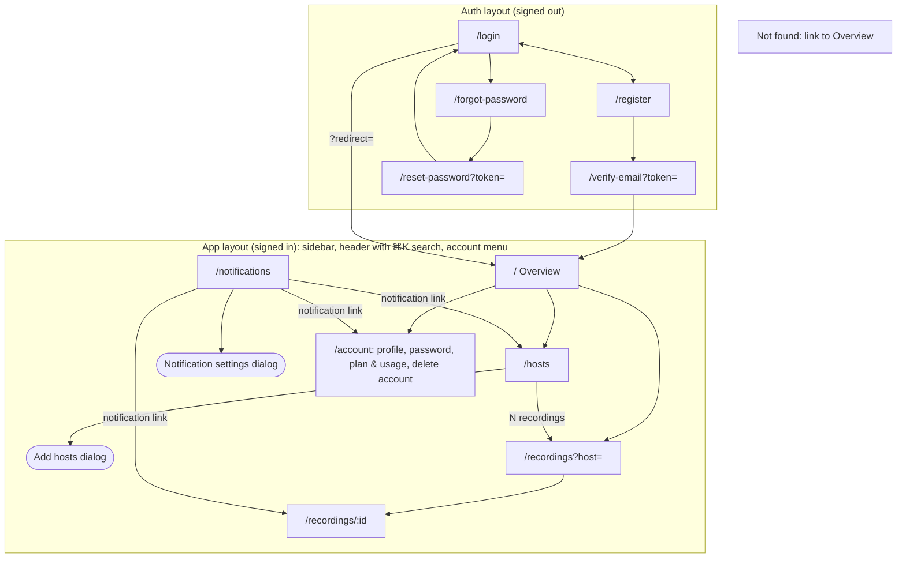
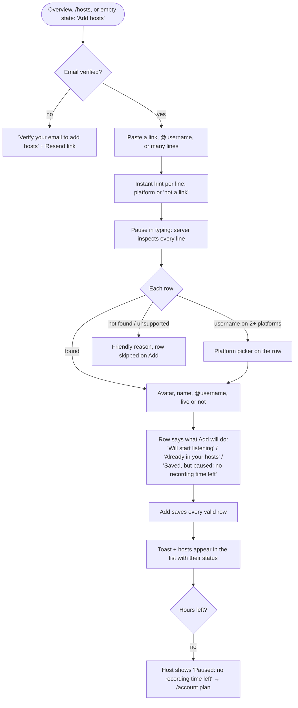
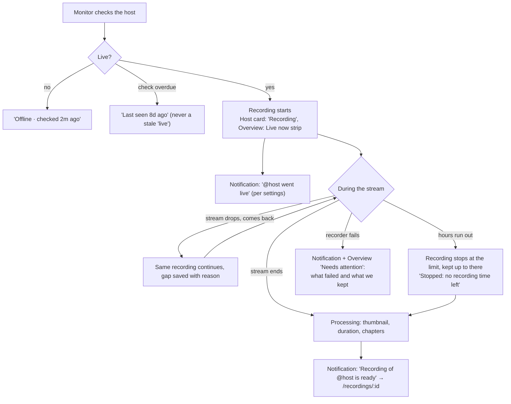
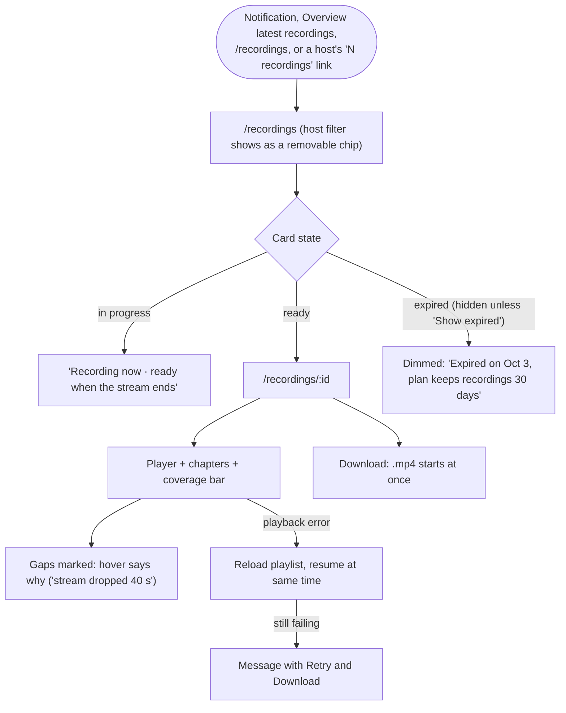
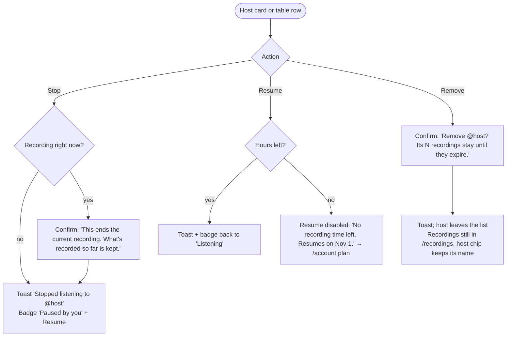
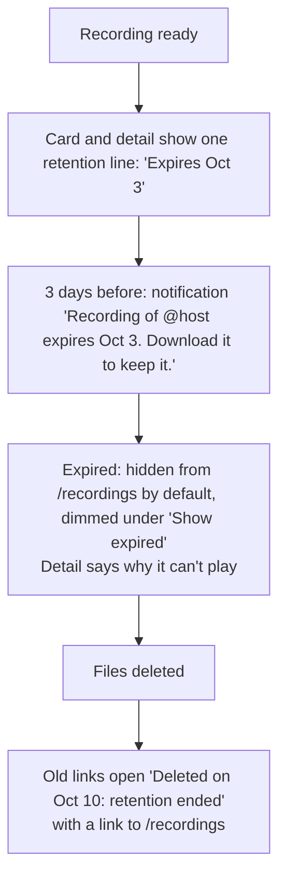
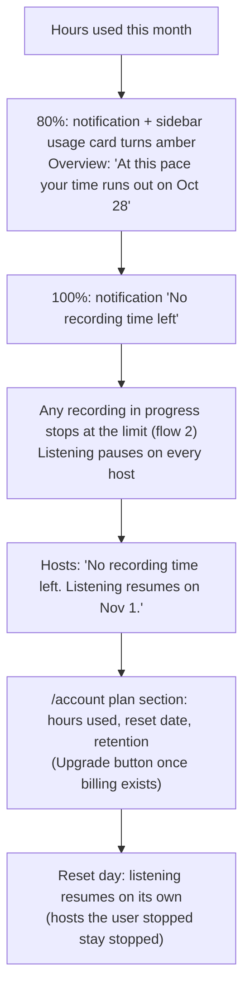
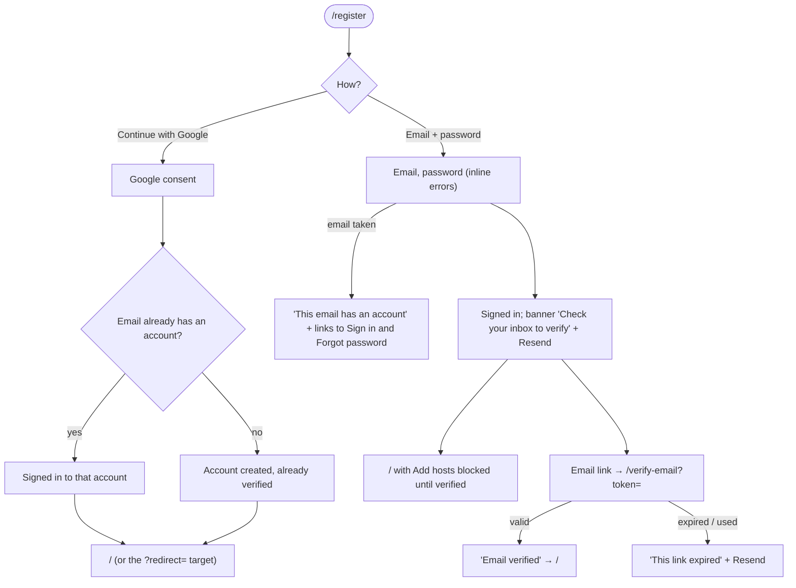
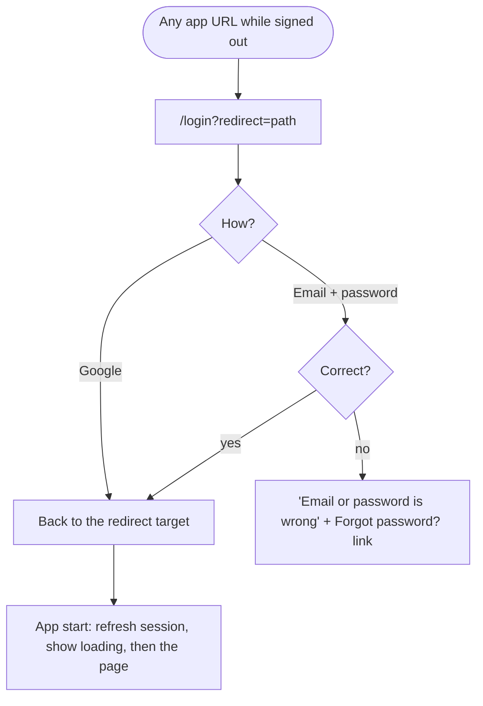
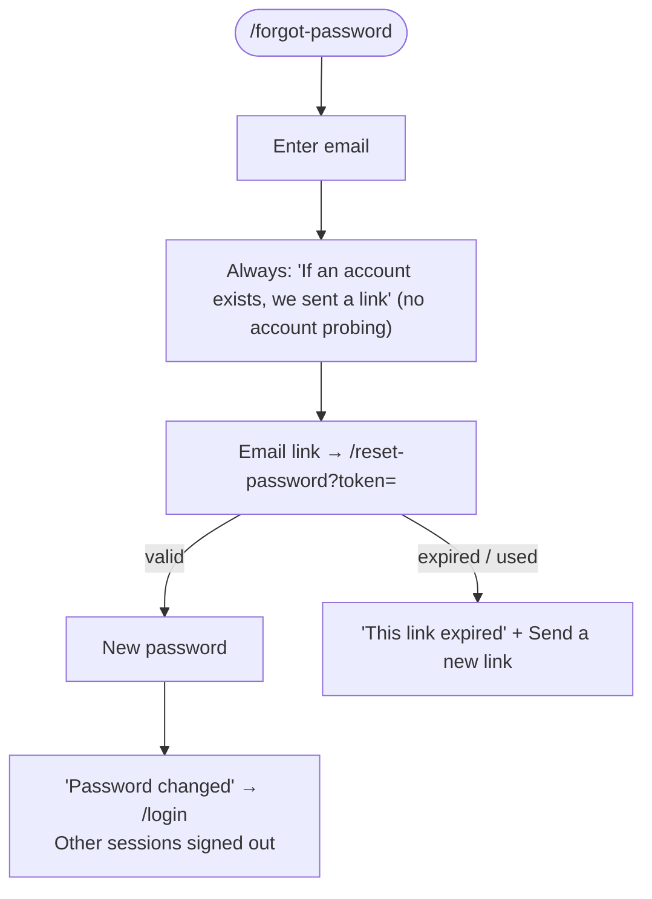

# User flows and sitemap

How people move through AutoRecordLive, agreed before any screen is drawn (ARL-1). Every design card (ARL-2 to ARL-14) draws its screens from these flows. Routes come from [`fe-arch.md`](./fe-arch.md#application-routes); the principles (P1–P8) are the [product principles](./roadmap.md#product-principles).

## Decisions

- **One limit: recording hours per month.** It resets monthly. Downloads are unlimited (rate-limited against abuse), and storage is capped by hours and retention, so there's no download or storage quota flow. A host followed by several users counts its full length against each follower's hours.
- **Running out of hours pauses listening, it never dead-ends.** Warnings come at 80% and 100%. At the limit, hosts say "No recording time left. Listening resumes on Nov 1." and link to the plan section of `/account`. Its Upgrade button arrives with billing.
- **Removing a host keeps its recordings** until their retention ends. Adding the host again resumes listening.
- **Sign-up:** email + password with email verification, or Google. An unverified account can sign in and look around, but can't add hosts until it verifies.
- **Google and email accounts with the same address are one account.** Google has already verified the address.

## Sitemap

- Every app route sends a signed-out visitor to `/login?redirect=<path>`, and signing in returns them there.
- A deleted or unknown recording at `/recordings/:id` opens a page that says why it's gone (R16), not the generic not-found page.
- Removed from the reference: `/add` and the export download route. Add hosts is a dialog on `/hosts`, and downloads start at once.

## Core flows

### 1. Follow a host

### 2. A host goes live and gets recorded

### 3. Watch or download a recording

## Secondary flows

### 4. Stop, resume, or remove a host

### 5. A recording expires

### 6. Recording time runs out

### 7. Sign up

### 8. Sign in

### 9. Reset password

A Google-only account can use this flow to add a password.

## Principles check

Each flow against **P4 no dead ends** and **P8 nothing disappears silently**, plus any other principle it leans on.

| Flow | No dead ends (P4) | Nothing disappears silently (P8) | Other |
| --- | --- | --- | --- |
| 1. Follow a host | Unverified users get Resend; bad rows say why; paused hosts link to the plan | Rows say exactly what Add will do (R22) | P3 paste anything |
| 2. Goes live, recorded | Failures land in Needs attention with a reason | Gaps, cut-offs, and failures say where, why, and what we kept | P1 status shows how old it is |
| 3. Watch or download | Expired and in-progress cards say why they can't play; playback errors offer Retry and Download | Expired recordings are hidden behind a filter, not removed | P2 lists update on their own |
| 4. Stop / resume / remove | Disabled Resume says why and when it comes back | Stopping mid-recording is confirmed; removing keeps recordings and says so | P5 icon buttons get labels |
| 5. Expires | Deleted links open a page with a way back | Retention line, warning 3 days before, deleted page says when and why (R16) | P7 only followers see it |
| 6. Time runs out | Paused hosts link to the plan and the reset date | Warnings at 80% and 100% before anything stops; forecast on Overview | — |
| 7. Sign up | Taken email links to Sign in and Forgot password; expired link offers Resend | — | — |
| 8. Sign in | Wrong password links to Forgot password; redirect returns you where you were | — | — |
| 9. Reset password | Expired link offers a new one | Other sessions are signed out, and the page says so | — |
