# User flows and sitemap

How people move through AutoRecordLive, agreed before any screen is drawn (ARL-1). Every design card (ARL-2 to ARL-14) draws its screens from these flows. Routes come from [`fe-arch.md`](./fe-arch.md#application-routes); the principles (P1–P8) are the [product principles](./roadmap.md#product-principles).

## Decisions

**Hosts and recording**

- **Following a host and recording it are separate.** We check the live status of every host you follow. Each host has **auto-record** on or off: on records every broadcast by itself, off only tells you it's live. You choose when adding hosts (on by default) and can change it any time.
- **You can always record or stop by hand.** **Record now** starts recording a live host from that moment. **Stop recording** ends the current recording and keeps what was captured. After a manual stop, auto-record waits for the next broadcast instead of starting again.
- **Recordings are shared but your actions are yours.** One recorder runs per broadcast for everyone who wants it. Your recording covers the time it recorded for you, your Stop doesn't stop anyone else's, and removing a recording hides it only for you.
- **Removing a host keeps its recordings** until their retention ends. Adding the host again starts fresh with the auto-record choice in the Add dialog.

**Recordings**

- **The recording page is a simple editor.** A timeline under the player shows recorded spans, gaps, and chapters. Select one or more sections and download each as its own `.mp4`, or download the whole recording. Section edges snap to the recording's segments (about 6 s), so the file starts and ends where the timeline shows.
- **Removed recordings go to a recycle bin.** You can restore them. They're deleted for good 30 days after removal, or when their retention ends if that comes first. There's no "delete forever" button.
- **Removing a recording doesn't give back recording time.** Time counts when it's recorded.

**Limits**

- **One limit: recording hours per month.** It resets monthly. Downloads are unlimited (rate-limited against abuse), and storage is capped by hours and retention, so there's no download or storage quota flow.
- **Running out of hours pauses recording, never the app.** Warnings come at 80% and 100%. At the limit, recording stops, auto-record pauses, and Record now is disabled, each saying "No recording time left. Recording resumes on Nov 1." with a link to the plan section of `/account`. Its Upgrade button arrives with billing. Live status keeps updating, because checks don't use hours.
- **Usage lives on the Overview and `/account`, not in the sidebar.**

**Accounts**

- **Email is the account.** The same email signs in with Google or with a password, whichever the user likes.
- **Nothing works until the email is verified.** A signed-in but unverified user only sees `/verify-email`. Google sign-ins are verified already, and so is anyone who completes a password reset.
- **Google sign-in on an unverified account takes it over.** Google proves the address, so we verify the account and drop its unproven password. This stops someone from registering another person's email first and keeping a way in.

## Feedback: toast, notification, or status

A toast isn't a notification. Each kind of feedback has one job:

| Kind | When | Where it lives |
| --- | --- | --- |
| **Toast** | Result of something you just did: hosts added, auto-record turned off, recording removed (with Undo) | Pops up once and disappears. Nothing is stored |
| **Notification** | Something happened without you: host went live, recording ready or failed, recording stopped at the limit, usage at 80% / 100%, recording expires soon | Stored in `/notifications` with an unread badge in the sidebar, plus email or other channels per the notification settings |
| **Status** | What's true right now | On the item itself: badges on host cards, retention line on recording cards |

So adding a host gives a toast and the host appears with its status, but no notification (the reference sends one, R21).

## Sitemap

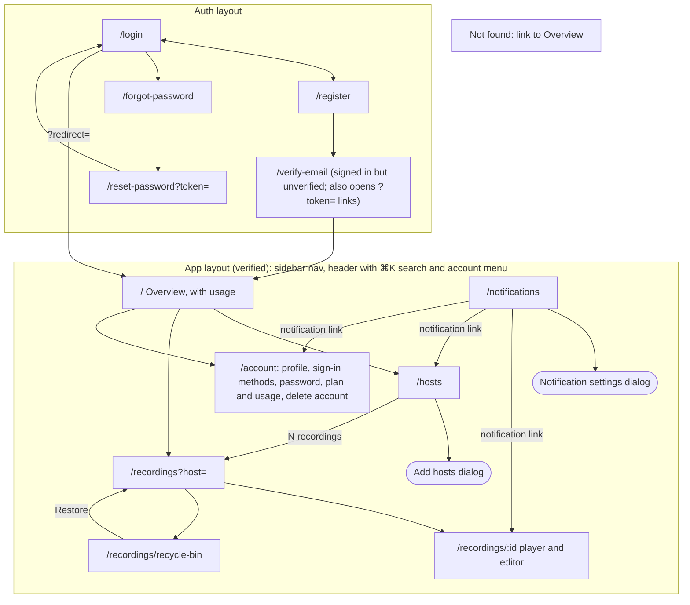

- **Signed out:** every app route sends you to `/login?redirect=<path>`, and signing in returns you there.
- **Signed in, unverified:** every app route shows `/verify-email` until the email is verified, then continues to where you were going.
- **Sidebar:** Overview, Hosts, Recordings, Notifications (unread badge), Account. No usage card.
- **Recordings that aren't there:** a removed, expired, or deleted recording at `/recordings/:id` opens a page that says what happened, when, and what you can do (Restore, or back to Recordings), not the generic not-found page (R16).
- **Removed from the reference:** `/add` and the export download route. Add hosts is a dialog on `/hosts`, and downloads start at once.

## Host card

Every host card (and table row) answers three questions in words, with an icon beside the text (P5):

| Question | What it shows |
| --- | --- |
| Is it live? | "Live", "Offline · checked 2m ago", or "Last seen 8d ago" when the check is overdue (P1) |
| Is it recording? | "Recording · 12:34" while recording for you |
| Will it record when it goes live? | "Auto-record on", "Auto-record off", or "Auto-record paused: no recording time left" |

Actions: **Record now** (live and not recording), **Stop recording** (recording), the **auto-record** switch, **Remove**, and the "N recordings" link to its recordings. An unavailable action stays visible, disabled, with a tooltip that says why (P4).

## Core flows

### 1. Follow a host

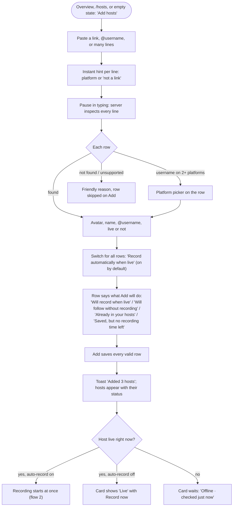

### 2. A host goes live and gets recorded

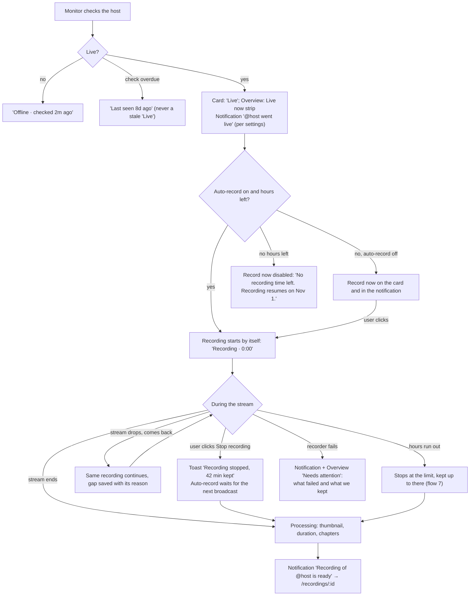

### 3. Watch, cut, or download a recording

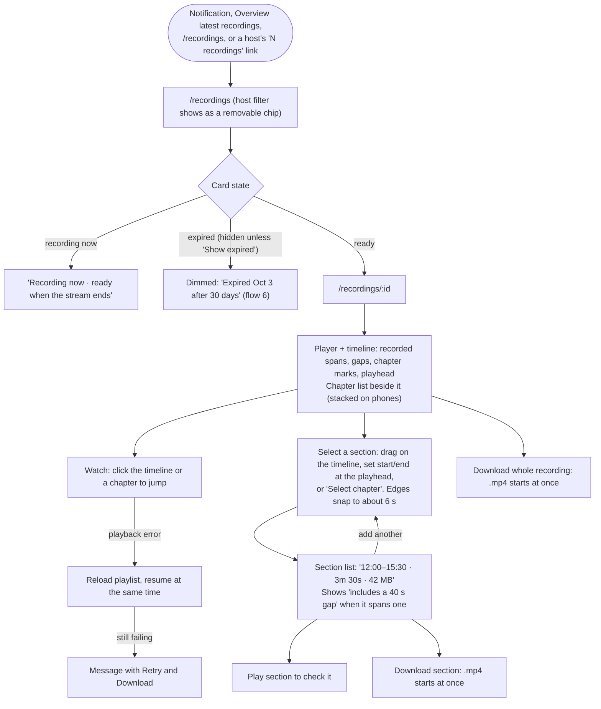

Gaps show on the timeline as hatched spans; hovering one says why ("stream dropped for 40 s, reconnected"). The timeline's handles are big enough to drag on a phone (P6).

## Secondary flows

### 4. Manage a host

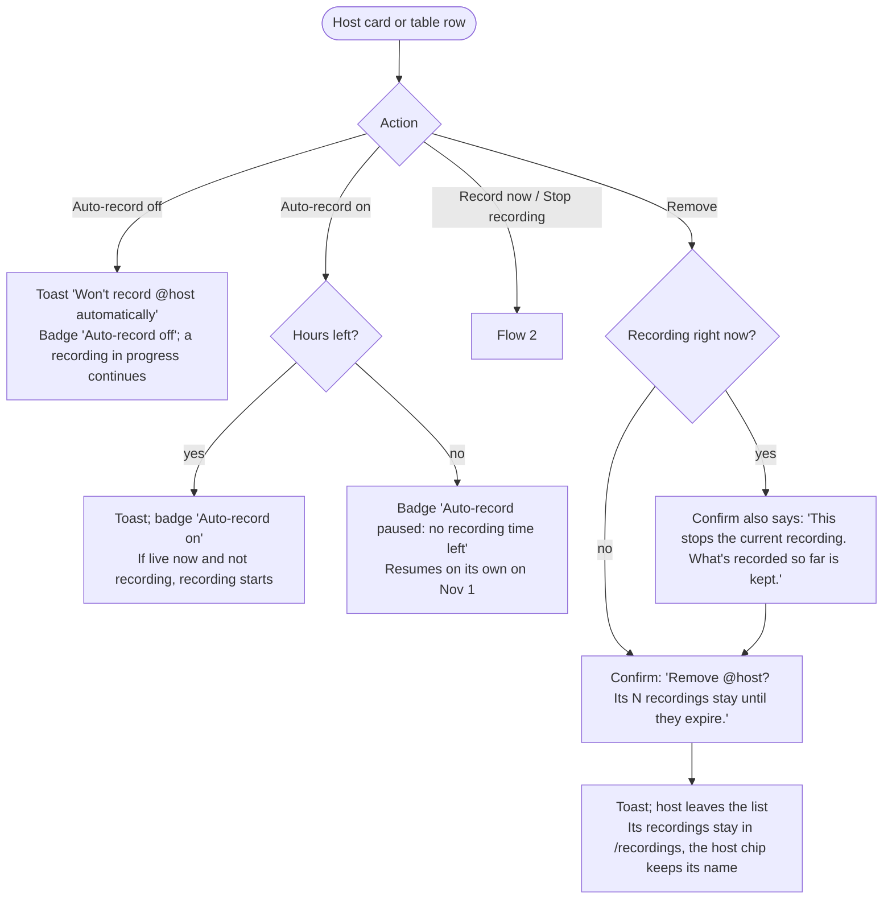

### 5. Remove and restore a recording

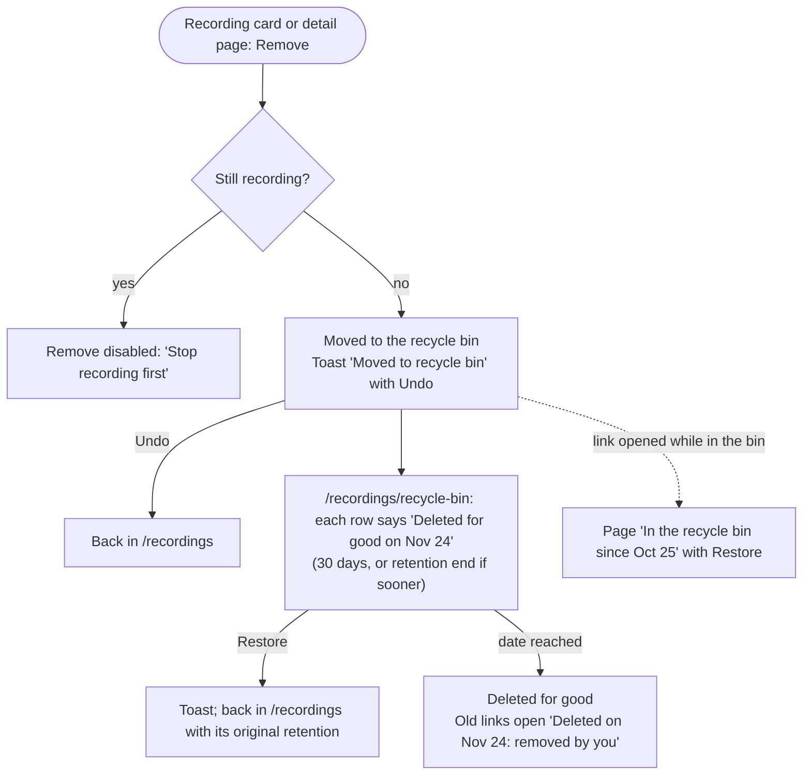

Only you lose the recording. Other followers of the host keep theirs.

### 6. A recording expires

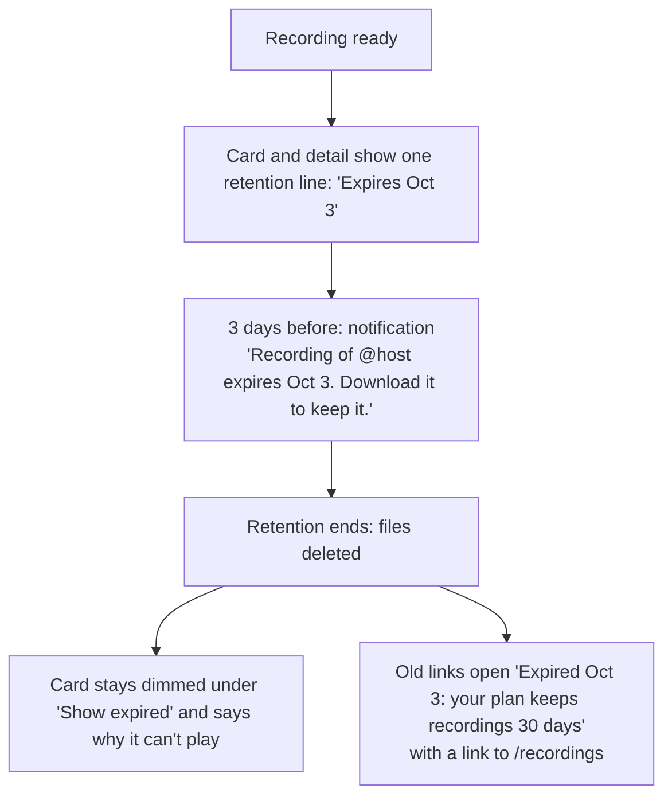

### 7. Recording time runs out

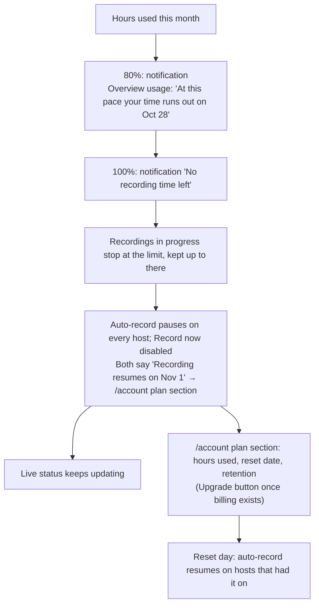

### 8. Sign up and verify

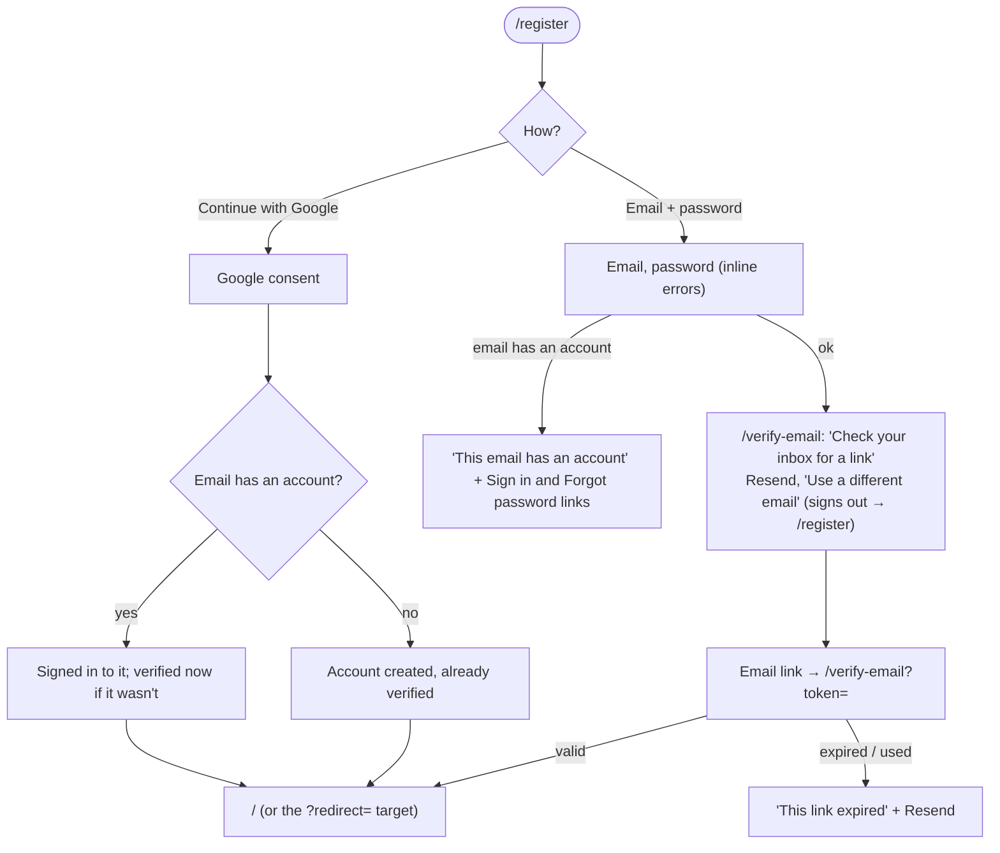

### 9. Sign in

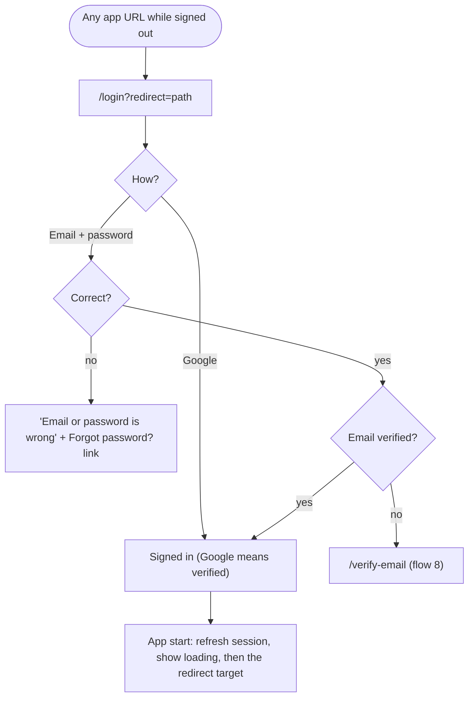

The error never says whether the email exists or signs in with Google only.

### 10. Reset password

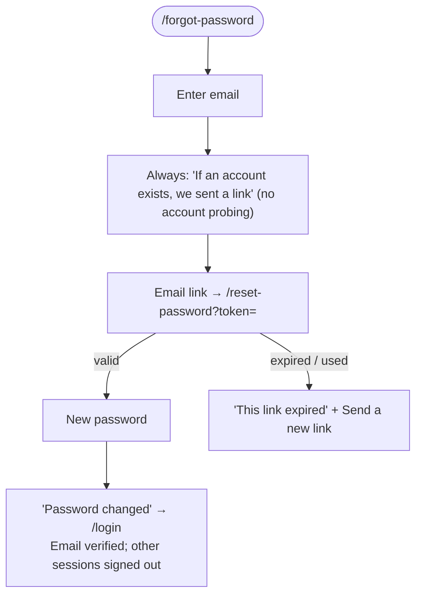

This is also how a Google-only account adds a password. `/account` lists the sign-in methods an account has.

## Principles check

Each flow against **P4 no dead ends** and **P8 nothing disappears silently**, plus any other principle it leans on.

| Flow | No dead ends (P4) | Nothing disappears silently (P8) | Other |
| --- | --- | --- | --- |
| 1. Follow a host | Bad rows say why; hosts saved without time left say so and link to the plan | Rows say exactly what Add will do (R22) | P3 paste anything |
| 2. Goes live, recorded | Auto-record off still offers Record now; disabled Record now says why and when | Manual stops, gaps, cut-offs, and failures say what we kept | P1 status shows how old it is |
| 3. Watch, cut, download | Expired and in-progress cards say why they can't play; playback errors offer Retry and Download | Sections that span a gap say so before download | P6 timeline works by touch |
| 4. Manage a host | Disabled actions say why | Removing a host says its recordings stay; removing while recording says what's kept | P5 every badge is text, not just an icon |
| 5. Remove a recording | Undo, Restore, and a page for links to removed recordings | Every bin row shows the day it's deleted for good | P7 removal affects only you |
| 6. Expires | Expired links open a page with a way back | Retention line, warning 3 days before, page says when and why (R16) | P7 only followers see it |
| 7. Time runs out | Paused hosts link to the plan and the reset date | Warnings at 80% and 100% before anything stops; forecast on Overview | P1 live status keeps updating |
| 8. Sign up and verify | Resend, and 'Use a different email' for a typo | — | — |
| 9. Sign in | Wrong password links to Forgot password; unverified goes to the verify page; redirect returns you | — | — |
| 10. Reset password | Expired link offers a new one | Other sessions are signed out, and the page says so | — |
