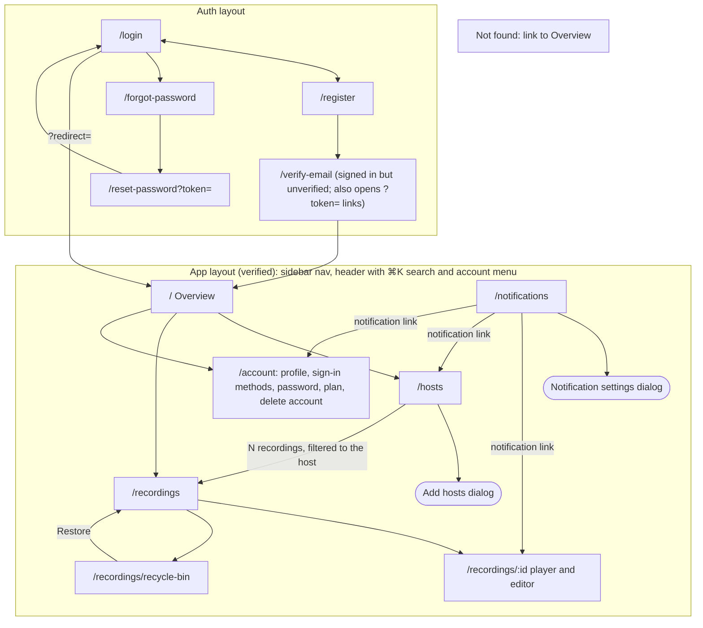
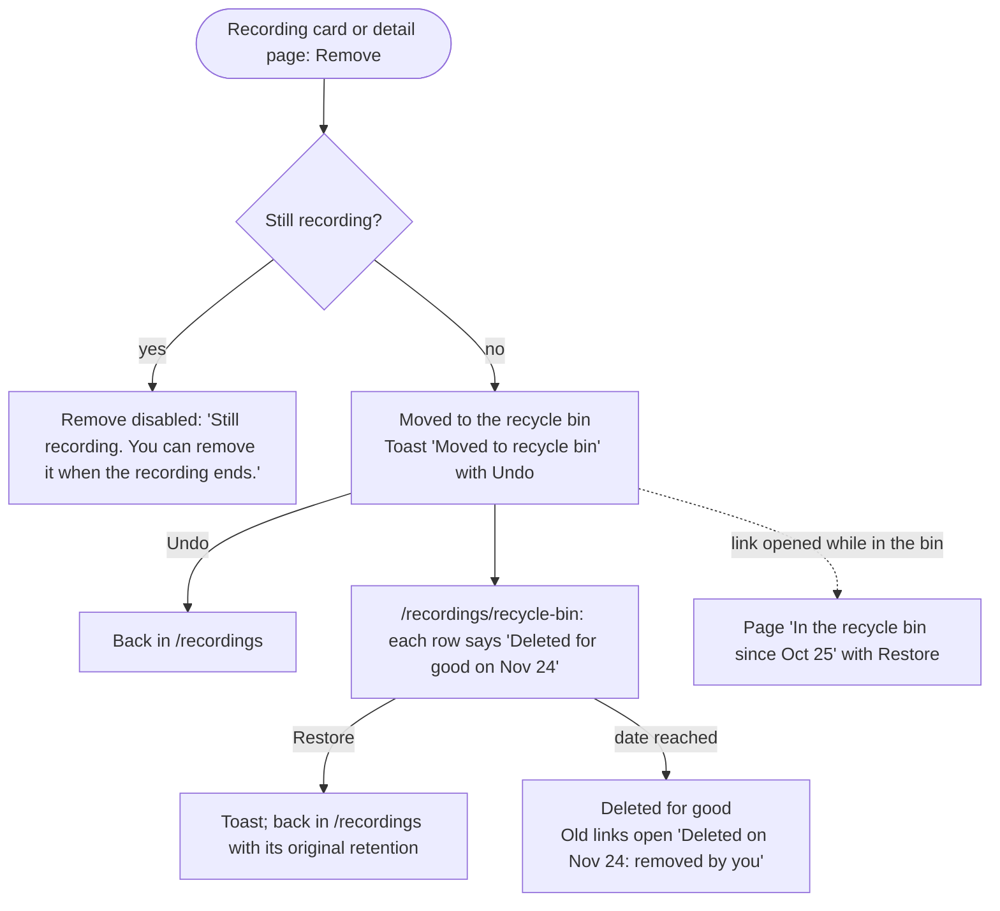
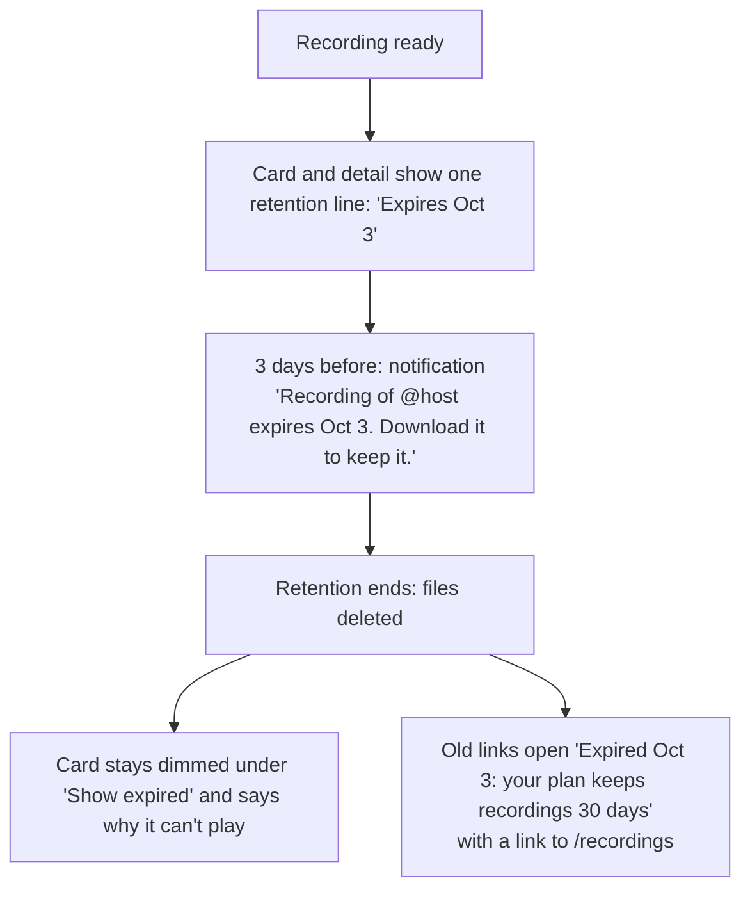
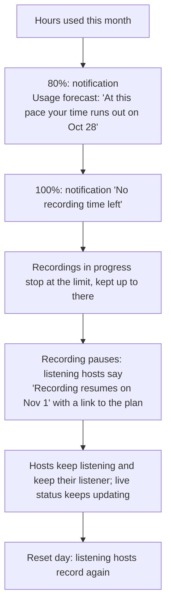

# User flows and sitemap

How people move through AutoRecordLive, agreed before any screen is drawn (ARL-1). Every design card (ARL-2 to ARL-14) draws its screens from these flows. Routes come from [`fe-arch.md`](./fe-arch.md); the principles (P1–P8) are the [product principles](./roadmap.md).

## Decisions

**Hosts and listeners:** see the [hosts user flows](./user-flows-hosts.md): listening, active listeners, live checks, recording, and removing hosts.

**Recordings**

- **The recording page is a simple editor** (flow 3). Select one or more sections on the timeline and download each as its own `.mp4`, or download the whole recording. Section edges snap to the recording's segments (about 6 s), so the file starts and ends where the timeline shows.
- **Removed recordings go to a recycle bin** (flow 5). You can restore them. They're deleted for good after 30 days, or when their retention ends if that's sooner. There's no "delete forever" button.
- **Removing a recording doesn't give back recording time.** Time counts when it's recorded.
- **Removing a recording hides it only for you.** Recordings are shared per broadcast, so others who follow the host keep theirs.

**Limits and usage**

- **Two limits: recording hours per month and active listeners.** Hours reset monthly. Downloads are unlimited (rate-limited against abuse), and storage is capped by hours and retention, so there's no download or storage quota.
- **Running out of hours pauses recording, never the app** (flow 7).
- **Usage shows on the Overview and `/account` only.** The one exception is the listener count, which `/hosts` also shows because that's where listening is managed. Anywhere else, a limit appears only where it blocks something, saying why, with a link to the plan in `/account`. That page gets an Upgrade button once billing exists.

**Accounts:** see the [account user flows](./user-flows-auth.md): sign-up, sign-in, email verification, and password reset.

**Notifications and messages:** see the [notifications user flows](./user-flows-notifications.md): when to use a toast, a notification, a status, an inline message, or a confirmation, and the catalog of every core message.

## Sitemap

- **Sidebar:** Overview, Hosts, Recordings, Notifications (unread badge), Account.
- **Recordings filters:** which filters `/recordings` has, and their URL params, aren't decided yet.
- **Recordings that aren't there:** a removed, expired, or deleted recording at `/recordings/:id` opens a page that says what happened, when, and what you can do (Restore, or back to Recordings), not the generic not-found page (R16).
- **Removed from the reference:** `/add` and the export download route. Add hosts is a dialog on `/hosts`, and downloads start at once.

## Core flows

Flows 1 (Follow a host) and 2 (A host goes live and gets recorded) are in the hosts user flows.

### 3. Watch, cut, or download a recording

Gaps show on the timeline as hatched spans; hovering one says why ("stream dropped for 40 s, reconnected"). The timeline's handles are big enough to drag on a phone (P6).

## Secondary flows

Flow 4 (Manage a host) is in the hosts user flows.

### 5. Remove and restore a recording

### 6. A recording expires

### 7. Recording time runs out

Flows 8 (Sign up and verify), 9 (Sign in), and 10 (Reset password) are in the account user flows. Flows 11 (A notification reaches you), 12 (Read and act on notifications), and 13 (Choose what reaches you) are in the notifications user flows.

## Principles check

Each flow against **P4 no dead ends** and **P8 nothing disappears silently**, plus any other principle it leans on. Flows 1, 2, and 4 are checked in the hosts user flows, 8, 9, and 10 in the account user flows, and 11, 12, and 13 in the notifications user flows.

| Flow | No dead ends (P4) | Nothing disappears silently (P8) | Other |
| --- | --- | --- | --- |
| 3. Watch, cut, download | Expired and in-progress cards say why they can't play; playback errors offer Retry and Download | Sections that span a gap say so before download | P6 timeline works by touch |
| 5. Remove a recording | Undo, Restore, and a page for links to removed recordings | Every bin row shows the day it's deleted for good | P7 removal affects only you |
| 6. Expires | Expired links open a page with a way back | Retention line, warning 3 days before, page says when and why (R16) | P7 only followers see it |
| 7. Time runs out | Paused hosts say when recording resumes and link to the plan | Warnings at 80% and 100% before anything stops, plus a forecast | P1 live status keeps updating |
